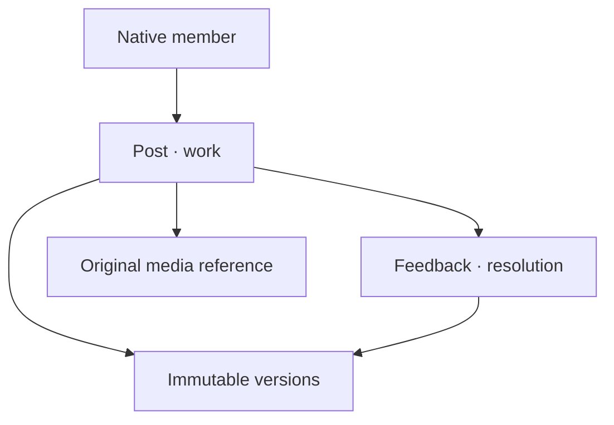
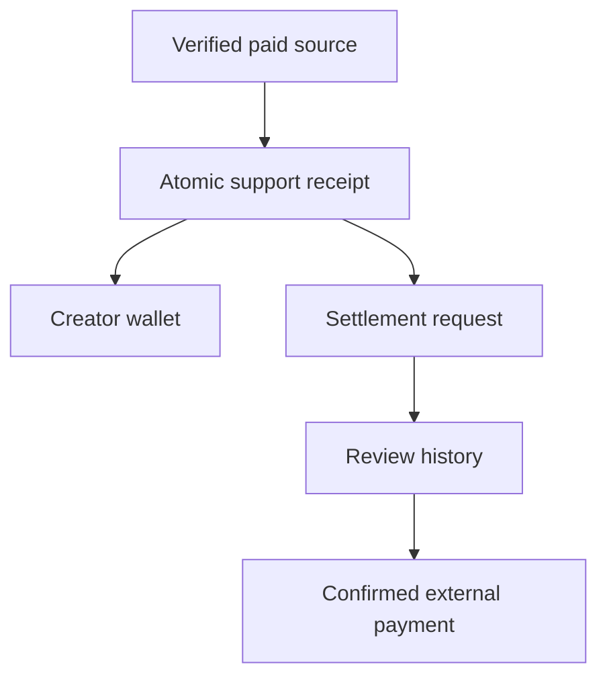

# NOA community, commerce and creator journeys

## Information architecture

The global Home, Back, Top and whole-menu controls remain in the shared shell. SHOP, Lounge and LAB also share one compact cross-navigation. MY routes to channel management and support/settlement. Native GnuBoard boards retain their original visibility and login routes.

| Entry | Main action | Completion | Recovery |
|---|---|---|---|
| Music / WORLD / channel | Open configured related goods | Official Marpple option/payment page | Return to saved NOA purchase list |
| Music | Share existing track into Lounge | Published post with original music reference | Preserve source; resolve stale revision before retry |
| Lounge | Read news, discuss, vote, save | Updated post and account activity | Login for membership; explicit empty/error state |
| LAB | Publish work, request focused feedback | Version comparison and improvement record | Previous immutable version remains available |
| Collaboration | Read roles, rights, schedule, compensation | Consent-bound application and owner decision | Private application history, no implied contract |
| Creator / song | Enter support within available points | Confirmed atomic debit and receipt | Same request ID recovers uncertain response |
| MY support | Submit verification and settlement request | Audited manual review stages | Hold/reject preserves a trace and restores reservations |

## Data relationships

## Components and states

Two-column mobile cards preserve equal grid widths. Desktop columns use available content width inside the shared navigation shell. Loading/error/empty/permission-required states have distinct text and recovery actions. Dialogs use native modal semantics, labelled fields, close controls and focus return. Status announcements use live regions; controls retain 44px touch targets and reduced-motion support. Version comparison stacks on narrow screens. Images use lazy loading except the main hero and preserve aspect ratios.

## Integration and operating boundaries

No second identity database or duplicated audio catalog is introduced. Generic storage writes cannot bypass module-specific ACLs. Product metadata is an editorial snapshot, not inventory synchronization. Marpple final price, fulfillment and refund operations stay with the official seller. Native VIP/points checkout stays with the established payment integration. Financial provenance is checked against existing live credited payments; no cash settlement is enabled by this release. Identity evidence, provider contract, legal applicability and tax classification require actual operator review. Unknown origin and reversed sources remain ineligible.
