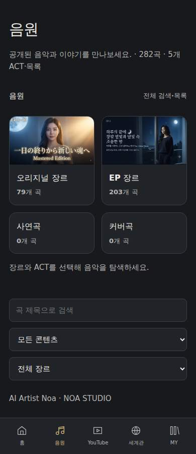
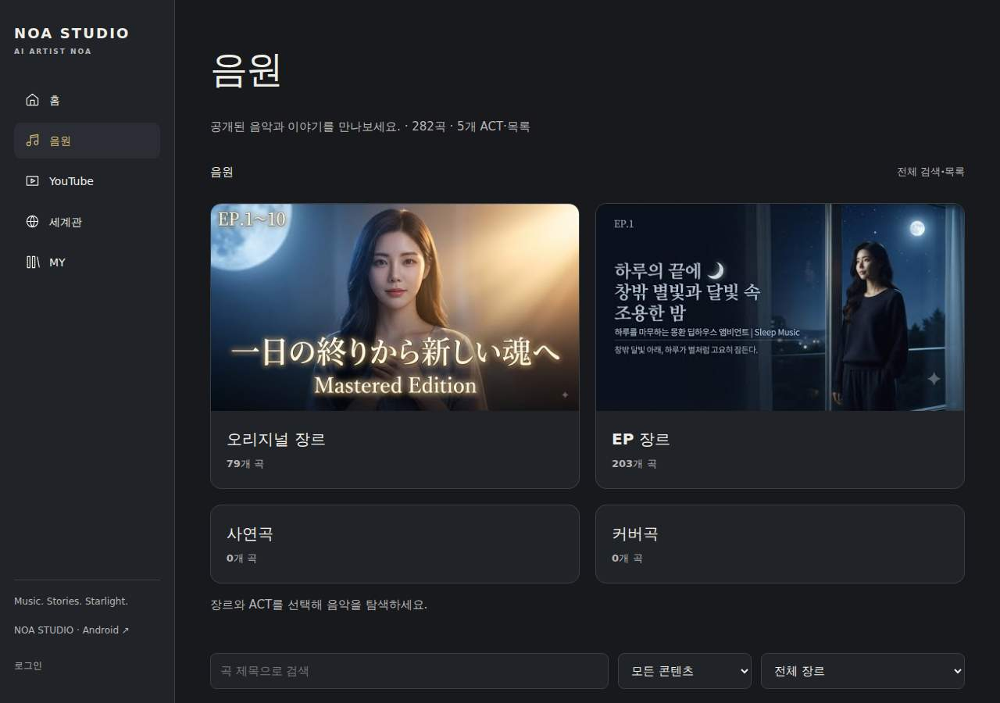
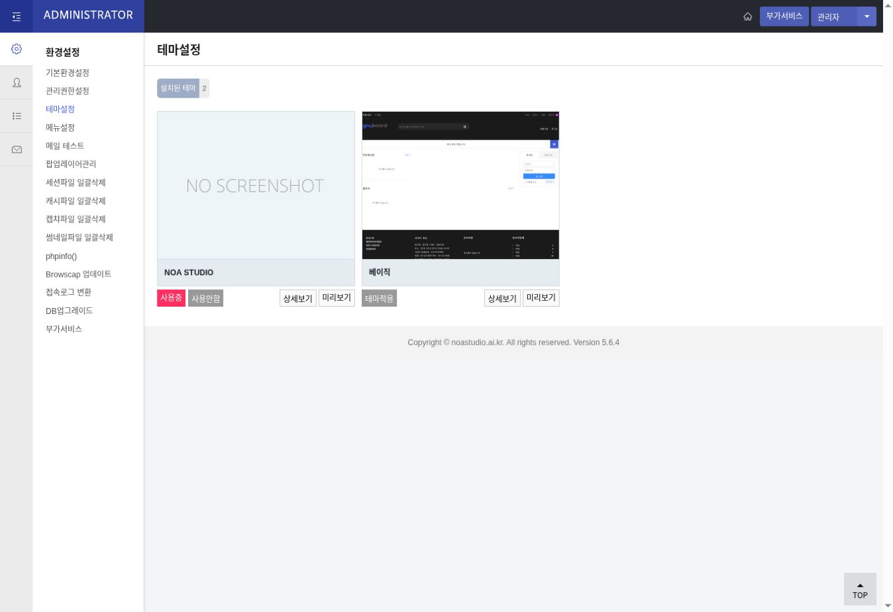

# NOA STUDIO 운영 품질 점검 — 2026-10-20

신규 제작 기능 확장을 중단하고 기존 운영 기능을 수정했다. 별도 프리뷰를 만들지 않았다. 아래에서 ‘검증’은 범위를 명시하며, 코드와 테스트용 성공을 실제 음악·기기 성공으로 바꾸어 표현하지 않는다.

## 실제 완료

- 정식 도메인에 모바일 카드, 제목 줄바꿈, 플레이어 너비, 하단바 겹침, 그누보드 검색 너비를 수정 배포했다.
- PC와 모바일의 주요 메뉴를 홈 / 음원 / YouTube / 세계관 / MY로 일치시켰다. 관리자·제작 도구는 MY의 별도 작업 영역으로 이동했다.
- 음원과 YouTube를 4대 분류 → 기존 장르 → 실제 ACT → 수록곡으로 탐색한다. 전체 검색, 24개 단위 페이지, 기존 개별 상세 링크를 유지한다.
- 일반 곡 재생 대기열에서 ACT 전체 편집본을 제외했다. 개인 플레이리스트의 명시적 순서는 유지한다.
- 재생 버튼을 접근성 이름과 활성 상태가 있는 아이콘으로 정리했다. 모바일의 반복·셔플은 더보기로 연다.
- 소유 채널의 제목에 명시된 공식 MV 34개를 일반 영상과 구분한다. 수동 분류가 우선하고 불확실한 곡 매칭은 변경하지 않는다.
- 메타데이터 검토 5건을 관리 화면에 표시한다. 임의 제목 교정이나 URL 추측은 하지 않았다.
- NOA 테마 설명 파일의 형식 오류로 발생하던 관리자 PHP 경고를 수정했다. 이후 사용자 적용 후 NOA STUDIO 활성화를 확인했다.
- GitHub 자동 품질 검사를 추가했다. 운영 데이터는 읽기 전용으로 검사하며, DB 쓰기·권한·오디오 처리 테스트는 격리된 환경에서 수행한다.

### 실제 배포 파일

서버 루트 기준, 저장소 소스는 `deploy/` 및 `bridge/`에 있다. 일부 관리 PHP는 공통 자산 버전 갱신이다.

```
noa-browse.js
noa-home.js
noa-music.css
noa-ui-words.json
noa-ui.css
noa-ui.js
noa-youtube.js
noa-ai-lab.php
noa-catalog-admin.php
noa-catalog.php
noa-editor.php
noa-library.php
noa-music.php
noa-my.php
noa-settings.php
noa-theme-admin.php
noa-youtube-admin.php
noa-youtube.php
noa2.php
extend/noa.design.php
noa-bridge/youtube-core.php
noa-bridge/youtube-store.php
theme/noa_studio/readme.txt
theme/noa_studio/head.php
theme/noa_studio/mobile/head.php
theme/noa_studio/skin-bridge.php
```

GnuBoard 코어, 원본 음원/문서, 기존 DB 데이터를 삭제하거나 초기화하지 않았다. 해시가 다른 운영 파일을 무조건 덮어쓰지 않는 배포 보호를 사용했다.

### 운영 URL

- [홈](https://noastudio.ai.kr/noa2.php)
- [음원](https://noastudio.ai.kr/noa-music.php)
- [통합 라이브러리](https://noastudio.ai.kr/noa-catalog.php)
- [YouTube](https://noastudio.ai.kr/noa-youtube.php)
- [공식 MV 34개](https://noastudio.ai.kr/noa-youtube.php?world=1)
- [MY](https://noastudio.ai.kr/noa-my.php)
- [관리자 원본 검토](https://noastudio.ai.kr/noa-library.php) — 로그인·권한 필요
- [SQL 카탈로그 관리](https://noastudio.ai.kr/noa-catalog-admin.php) — 로그인·권한 필요
- [YouTube 성장 관리](https://noastudio.ai.kr/noa-youtube-admin.php) — 로그인·권한 필요
- [AI LAB](https://noastudio.ai.kr/noa-ai-lab.php) — 실제 생성 제약은 아래 표 참고
- [Android 다운로드](https://noastudio.ai.kr/noa-download.php) — 기존 서명의 빌드 13 유지

### 검증 증거

| 검사 | 실제 결과 |
|---|---|
| 최초 서버/소스 비교 | 비교 가능한 85개 파일 일치, 로컬 생성물이 없는 4개는 별도 분류 |
| 최종 서버/소스 비교 | [39413903695](https://github.com/rucyjeon79/noa-studio/actions/runs/39413903695), 89개 파일 일치, 차이0. 로컬 미생성 미디어 상태/아이콘 3개는 해시 비교 제외. G5 보호 파일 해시는 최초와 동일 |
| 정식 사이트 최종 릴리스 | [39413415524](https://github.com/rucyjeon79/noa-studio/actions/runs/39413415524), 전체 성공 |
| 반응형 | 18개 경로 × 7개 너비 = 126개 검사 성공. 17개 화면과 APK 다운로드 검증 포함 |
| 실제 UI 흐름 | 4분류·장르·ACT·곡 선택, 이전/다음, 10곡 대기열, 반복/셔플, 전체 검색·페이지 이동, 공식 MV, 아이보리/일본어 설정 유지 성공 |
| 엔진·보안 회귀 검사 | [39413415533](https://github.com/rucyjeon79/noa-studio/actions/runs/39413415533), 성공 |
| 격리 MySQL/PHP/FFmpeg | 601곡/52ACT 재실행·중복 방지, G5 보호, OAuth/CSRF/작업 인증·실패 복구, 실제 FFmpeg 처리 성공 |
| JS·오디오 테스트 | Node 19개, DSP Python 2개 성공. 실제 운영 원곡 처리 성공을 뜻하지 않음 |
| 공개 HTTP 경계 | 15개 주요 경로 및 비로그인 접근 보호 검사 성공 |




## 발견한 문제

| 위치·재현 | 원인 | 조치·잔여 상태 |
|---|---|---|
| 음원 카드, 모든 검사 너비 | 공통 button의 inline-flex가 카드 내부를 가로로 압축 | song에 명시적 block/너비/줄바꿈 적용, 재검사 통과 |
| 320/360px 플레이어 | 자식 영역의 기본 최소 너비 | min-width와 넘침 처리 수정 |
| 320px 하단바·플레이어 | 상속된 nav gap와 항목 수 차이 | 5개 항목, gap/안전 영역/고정 높이 수정 |
| 320/360px 그누보드 검색 | fieldset 및 입력 영역 최소 너비 | 유연한 입력 너비로 수정 |
| PC/모바일 메뉴 불일치 | 관리 메뉴와 감상 메뉴 혼합 | 주요 메뉴 5개로 통일, 작업 영역 재배치 |
| 일반 대기열에 ACT 편집본 포함 | 곡·플레이리스트 문서 혼재 | 일반 곡 필터 수정, ACT1의 10곡 순서 검사 성공 |
| 공식 MV 화면에 영상 누락 | 모든 수집 영상의 기본 분류 music | 소유 채널·명시적 공식 MV 문구로 파생 표시, 34개/2페이지 확인 |
| 테마 관리자 PHP 경고 | readme의 고정 필드 형식 불일치 | 수정 배포, 경고 해소. 활성 테마 basic은 아직 유지 |
| J-POP ACT1~4 제목에 K-POP 라벨 | 원본 메타데이터 불일치 | 검토 4건, 원본 보존 |
| Latin EP24 YouTube URL | 유효한 11자리 ID 아님 | 검토 1건, 임의 수정 안 함 |
| Android 업데이트 | 기존 APK와 새 빌드의 서명 인증서 불일치 | 자동 배포 차단, 빌드13 유지. 원래 서명키 필요 |
| 원곡 재생·분석 | 보존된 곡의 실제 audioUrl 0개 | Suno 공유 주소를 오디오 주소로 사용하지 않음. 원본 파일 확보 필요 |
| 기존 PostgreSQL 스냅샷 2개 | WAL 손상으로 읽기 실패 | 보존, 초기화 안 함. 그곳에만 있는 추가 데이터는 미검증 |

사용하지 않는 파일을 추정해서 삭제하지 않았다. 기존 대형 Grok 번들 1,739개 파일과 오래된 APK는 복구·호환성 검토 대상으로 보존했다. 새 공유 탐색 컨트롤러와 공통 CSS를 사용하도록 중복 화면 동작을 정리했으며 전체 레거시 번들 제거는 완료하지 않았다.

## 음악 데이터

| 지표 | 결과·범위 |
|---|---|
| 접근 가능한 원본 고유 곡 | 601곡 |
| 운영 통합 고유 곡 | 601곡 |
| 원본 ACT 문서 | 52개 — 곡 수에 포함하지 않음 |
| 운영 플레이리스트 | 53개: ACT 52개 + 기존 개인 목록 1개 |
| 운영 수록 관계 | 530개, 각 목록 10곡, 순서 확인, 미해결 참조 0 |
| 검증된 원본 대비 누락 | 0곡. 손상 DB 전용 추가 기록까지 0이라고 판정하지 않음 |
| 통합 후 중복 곡 생성 | 0 — 반복 실행 검사 포함 |
| 이전 원본 중복 출현 병합 | 2,604회, 고유 곡 2,604개라는 뜻이 아님 |
| 정보 부족 | 199곡 — 이전 통합 보고서 기준 |
| 기존 충돌 검토 | 7곡/13필드. 새 메타데이터 경고 5건과 별도 지표 |
| 원본 보존 | 파일731/731, 음악문서653/653 일치, 누락·변경0 |
| 곡 필드 | 제목601, 가사601, Suno491, YouTube 값409(유효408), 직접 썸네일42, MV URL0, 실제 오디오URL0 |

장르·ACT별 수록곡 수:

| 장르 | 전체 곡 | ACT1 EP1–10 | ACT2 EP11–20 | ACT3 EP21–30 | ACT4 EP31–40 |
|---|---:|---:|---:|---:|---:|
| K-POP Original | 40 | 10 | 10 | 10 | 10 |
| J-POP Original | 40 | 10 | 10 | 10 | 10 |
| POP Original | 40 | 10 | 10 | 10 | 10 |
| THAI Original | 40 | 10 | 10 | 10 | 10 |
| Dreamy Deep House | 40 | 10 | 10 | 10 | 10 |
| Echoes of Joseon | 40 | 10 | 10 | 10 | 10 |
| EDM K-POP Club | 40 | 10 | 10 | 10 | 10 |
| Fantasy Ambient EDM | 40 | 10 | 10 | 10 | 10 |
| Groovy Airy Pop | 40 | 10 | 10 | 10 | 10 |
| Joseon Ballad | 40 | 10 | 10 | 10 | 10 |
| Latin Afrobeats EDM | 40 | 10 | 10 | 10 | 10 |
| Narrative Piano Indie | 40 | 10 | 10 | 10 | 10 |
| Panpop | 40 | 10 | 10 | 10 | 10 |
| 사연곡 | 44 | 해당 없음 | 해당 없음 | 해당 없음 | 해당 없음 |
| 커버곡 | 37 | 해당 없음 | 해당 없음 | 해당 없음 | 해당 없음 |

개인 플레이리스트는 10곡이며 이름·소유자 등 비공개 정보는 이 공개 보고서에 기록하지 않는다. 위 ACT 52개 각각이 10곡 플레이리스트와 연결된다.

비로그인 공개 카탈로그는 287개 레코드(곡282+ACT5)다. 모두 수집한 채널의 공개 영상 ID와 일치했다. 비공개·불확실 데이터까지 공개하여 601개로 맞추지 않았다. 언어/버전과 사용자 수정 정보는 보존했다. 원본 정규화 해시: `5775e08f24f14435205ce38e2b6d61c929393cbb1feae6862f9cf8e6d4d24af8`.

## UI/UX

- 검사 너비: 320 / 360 / 390 / 430 / 768 / 1280 / 1920px.
- 최초 자동 발견: 카드 압축7건, 검색 넘침2건, 하단바 충돌1건 = 화면 크기별 10건. 추가 관찰로 플레이어 자식 잘림 및 메뉴 불일치를 확인했다.
- 최종 동일 조건 검사: 가로 넘침·카드 압축·하단바 충돌·미처리 JS 예외 0건. 모든 디자인·접근성 결함이 없다는 뜻은 아니다.
- 카드, 긴 한글/YouTube 제목, 일본어·아이보리 설정, 페이지 분할을 실제 운영 UI에서 검사했다.
- 남음: 즐겨찾기 전체 기능, ACT 소설형 스토리의 완성도, 전체 601곡/모든 언어의 수동 시각 검사. 공개 사연곡/커버곡이 0개인 상태는 원본 삭제가 아니다.

## 그누보드

- 설치: basic 및 noa_studio. 최초 점검 시 basic, 20:41 KST 이후 재확인 시 noa_studio가 사용중.
- 전용 테마 파일과 공통 디자인 확장은 설치되어 있다. readme 경고는 수정했다.
- 기본 board/member/search 및 모바일 스킨이 남아 있다. 전용 어댑터는 기존 동작을 위임하므로 인증·권한·CSRF를 대체하지 않는다.
- 로그인·가입·비밀번호 찾기·검색·게시판의 공개 화면, 비로그인 관리자 접근 보호를 검사했다.
- 실제 회원 생성/수정/탈퇴, 운영 게시글·댓글·첨부파일 쓰기는 수행하지 않았다. 전체 쓰기 시나리오는 검증 필요다.
- 사용자가 적용 확인을 마친 뒤 관리자 화면에서 NOA STUDIO의 사용중 표시를 확인했다. 기본 스킨 전면 교체 완료로 판정하지 않는다.

## AI LAB / YouTube

| 기능 | 실제 상태 |
|---|---|
| AI 기획·가사·훅·번역·Suno 프롬프트·홍보문 | 구현됨, textAI 미설정/비활성, 실생성 미검증 |
| LUFS/True Peak·최적화 | FFmpeg/DSP 격리 처리 성공. 실제 라이브러리 원음0개여서 운영 원곡 검증 필요 |
| 하이라이트 | 처리 구조/검사 존재, 실제 곡 입력 검증 필요 |
| 영상·립싱크 | fal 미설정, generation 비활성. 실제 생성0건 |
| 작업 서버 | 운영 worker heartbeat 확인, 작업 목록0개 |
| YouTube OAuth/Data | 채널 소유자 연결. 영상765, 재생목록23, 전체 페이지 순회 완료 |
| 곡 연결 | 408개 매칭, 불확실357개 검토 유지, 누락 URL 보완0 |
| 공개 상태 | 공개/임베드 가능610, 비공개155. 현재 공개 카탈로그287건의 채널/공개 상태 불일치0 |
| Analytics | 실제 응답199영상행/408EP행/41ACT행, 2026-09-20~10-19. 노출·CTR 지표 미제공 |
| 유지율 | 공식 API 정상 응답이나 선택 영상 데이터0행, 수치 확보 미완료 |
| 공식 플레이어 | 영상 선택과 iframe 연결 성공. 클라우드 재생은 버퍼링/time0으로 실제 스트리밍 성공0건 |
| 업로드·예약 | 구현/격리 권한·재시도 검사. 실제 업로드는 실행하지 않음 |
| 자동 게시 | 채널 autoEnabled=false 유지 |

외부 API 키/토큰을 공개 소스·보고서·Android 앱에 기록하지 않았다. 비용 발생 생성이나 채널 게시를 시험 목적으로 실행하지 않았다. Suno 비공식 생성·스트림 API나 인증 우회로 원음을 확보하지 않았다.

## Android

- [빌드/에뮬레이터 검사](https://github.com/rucyjeon79/noa-studio/actions/runs/39411588567): 빌드·lint·테스트2개 성공, APK 생성. 게시 단계는 서명 불일치로 의도적으로 실패했다.
- 실제 Media3 로컬 PCM 테스트 음원: 전경1085ms → 백그라운드4002ms → 화면 꺼짐6523ms로 재생 진행. 미디어 알림/세션/제어 동작 확인.
- 테스트 음원은 생성한 검사용 PCM이며 기존 라이브러리 원곡이 아니다. 물리 기기 검사도 아니다.
- 네이티브 4분류/ACT/곡 목록, 5개 주요 메뉴, 긴 제목과 검색을 수정했다. WebView에서 YouTube는 백그라운드로 숨길 때 정지시킨다.
- 기존 다운로드 빌드13 유지, APK SHA256 `2d6a5131898eeaeb8eb98a58cc799cf9fb34551511d19bbd7ce1abfe6e2a2fd2` (4,579,329바이트).
- 기존 서명 `b2265d6925fc4eeb9e014ba3a985c040e92d26c8e20ead5e6d4e505bafda81f2`와 새 빌드 서명 `db73661e3f26cd675384c744c643bc4eed332b794dc91f2b75dad2b130283ad0`가 다르다. 원래 서명키 없이 기존 설치의 안전한 인플레이스 업그레이드를 완료했다고 보고할 수 없다.
- 남음: 원래 서명키 연결, 실제 기기 설치/로그인/원곡 재생/잠금화면 제어, 로그인한 웹과 네이티브 계정 데이터 일치. 삭제·재설치로 해결하지 않았다.

## Grok 대체 비교

기존 앱 v292.440의 장르15개와 K-POP ACT1의 실제 10곡·링크를 관찰했다. 기존 앱은 중단하지 않았다. 전체 기능 총수는 관리자 쓰기·SQL 전용 데이터까지 조사하지 못해 확정할 수 없다. 아래는 비교 범위를 명시한 20개 기능군이다. A는 해당 행의 범위만 실제 확인했다는 뜻이다.

| 기능군 | 상태 | 근거·남음 |
|---|---|---|
| 원본 음악 데이터 보존 | A | 731파일/653문서 일치 |
| 곡/ACT SQL 목록 | A | 601곡52ACT, 독립 테이블·관리 화면 |
| 수록곡/순서/개인 목록 보존 | A | 53목록530관계 |
| 곡 등록·편집·저장 | B | 구현, 이번 운영 쓰기 미검증 |
| 장르 관리 | B | 15장르 조회 확인, 관리 쓰기 미검증 |
| 가사/Suno URL 승계 | A | 원문 보존 검사, 공유/오디오 URL 분리 |
| YouTube 연결·수집 | A | OAuth/Data 실제 응답, 불확실 매칭 보류 |
| 음악 실제 재생 | F | 원곡 audioUrl0, YouTube 실제 스트리밍 미확인 |
| AI 음악 기획/가사/훅 | F | OpenAI 연결 필요 |
| 번역/홍보문/프롬프트 | F | OpenAI 연결 필요 |
| 음원 분석·최적화 | C | 테스트 엔진 성공, 운영 원곡 미검증 |
| 영상/립싱크 | F | 생성 서비스 연결 필요 |
| YouTube 게시 | B | 구조·격리 검사, 실제 게시 미검증 |
| 성장 분석 | A | 실제 Analytics 행 반환, 일부 지표 제약 |
| 캐릭터·세계관 | C | 기존 자료 보존, 소설형 화면 완성 미확인 |
| 공통설정/제작 규칙 | B | 원본 보존, 실제 생성 승계 비교 미검증 |
| 테마·디자인 설정 | C | 웹 설정 유지 및 G5 테마 활성화 확인, 전체 스킨 쓰기 검증 필요 |
| 다국어 UI | C | 일본어 설정 유지 확인, 전체 언어 미검증 |
| MY 즐겨찾기/보관함 | C | 기존 보관함 링크/최근 재생, 즐겨찾기 미구현 |
| Android 전체 대체 | C | 에뮬레이터 통과, 서명·기기·계정 검증 미완료 |

비교20군: A6 / B4 / C6 / F4. 전체 Grok 기능의 완전 대체 완료 수가 아니다. 기존 Node/Grok 번들과 손상된 DB는 보존하고 새 PHP/MySQL/작업 프로세스와 병행한다.

## 테마 활성화 후 추가 수정

- 2026-10-20 20:41 KST 이후 관리자 화면에서 NOA STUDIO 사용중 확인.
- 테마 이름이 보이지 않던 원인은 공통 소비자 CSS의 밝은 글자색과 GnuBoard 관리자 흰 패널의 충돌이었다.
- `extend/noa.design.php`에서 관리자 요청은 `/noa-admin.css`만 읽도록 분리했다. 관리자 테마 이름·버튼은 기본 UI의 대비를 유지하고 헤더만 차콜로 정리했다. 회원 화면의 소비자 테마/언어 설정은 유지한다. GnuBoard 코어 파일 수정 없음.
- 추가 서버 파일: `noa-admin.css`, 수정 서버 파일: `extend/noa.design.php`.
- 활성화 이후 [품질 재검증](https://github.com/rucyjeon79/noa-studio/actions/runs/39416835732) 전체 성공: 활성 테마 상태에서 7개 너비/126개 경로 검사와 실제 탐색 흐름 통과.

- 배포 중 확장 파일의 `.upload.php` 임시본도 그누보드가 읽어 중복 함수 오류가 일시 발생했다. 해당 배포의 최종 이름 변경 후 사이트 복구를 확인했다. 재발 방지를 위해 확장 PHP의 임시 업로드 위치를 `noa-bridge/`로 이동했다. 임시본이나 원본 데이터의 삭제로 우회하지 않았다.
- 관리자 화면에서 NOA STUDIO / 베이직 이름이 실제로 읽히고 NOA STUDIO 사용중 표시가 유지되는 것을 재검증했다.


