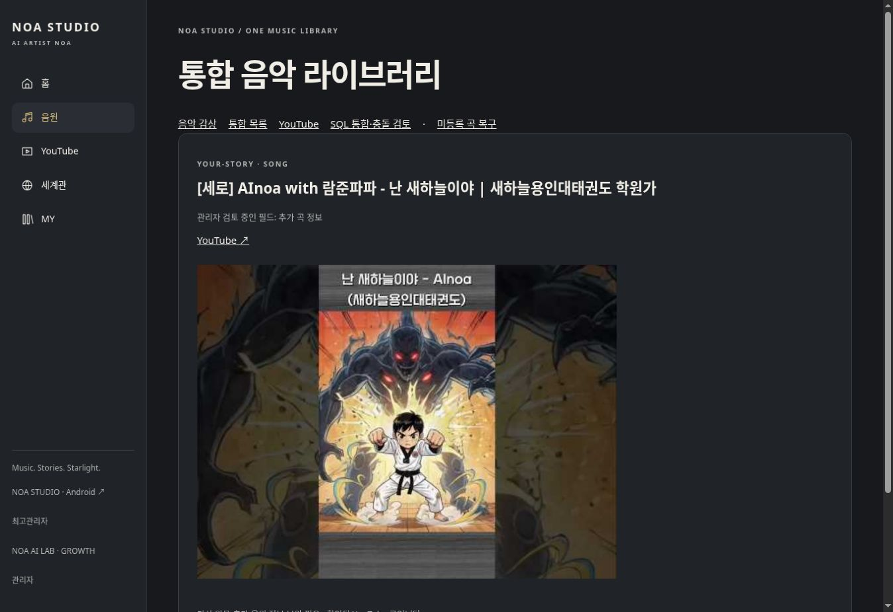

# 미등록 곡 복구 — 2026-10-21

정식 서버에서 실제 적용했다. 원본 데이터와 이전 SQL 판본을 유지하고 새로운 카탈로그 판본을 발행했다. 제목이 같거나 띄어쓰기·OST 표기만 다른 영상은 자동 병합하거나 새 곡으로 만들지 않았다.

## 실제 집계

| 요청 지표 | 실제 결과 |
|---|---:|
| 대조한 Grok·JSON·SQL 수집 원본 기록 | 3,466건 — 중복 출현 포함, 곡 수가 아님 |
| 수집 자료에서 식별한 고유 곡 | 601곡 |
| 복구 전 정식 등록 곡 | 601곡 |
| Grok 수집 자료에서 발견한 미등록 곡 | 0곡 |
| YouTube에서 확인한 미등록 음악 | 4곡 |
| 신규 정식 등록 완료 | 4곡 |
| 등록 후 정식 곡 | 605곡 |
| 기존 곡 정보 보완 | 368곡 — 빈 썸네일 필드, 가사·사용자 수정값 보존 |
| YouTube 수집 영상 | 765개 |
| YouTube 재생목록 | 23개 + 시스템 업로드 목록 별도 |
| 최초 대조의 중복 생성 방지 판정 | 568개 영상 — 기존 연결408 + 기존/버전 후보160 |
| 관리자 검토 필요 | 226개 영상 — 곡 수로 환산하지 않음 |
| 곡 자체가 아닌 댄스 홍보 영상 | 127개 — 곡 생성 제외 |
| 검토 중 ACT·묶음 영상 | 46개 — 위 226개에 포함 |
| 신규 곡의 컬렉션 연결 | 4곡 전부 연결, 10개 수록 관계 |
| 새 YouTube 컬렉션 판본 | 4개, 651개 순서 있는 관계 — 기존 곡 관계 포함 |
| 등록 후 ACT·플레이리스트 | ACT52개 유지, 전체 플레이리스트57개 |
| 확인된 잔여 미등록 | 0곡. 미확정 영상226개와 미접근 SQL 전용 자료는 별도 |

등록 후 전체 재대조: 등록 곡605, 이미 연결412영상, 신규 생성0, 추가 보완0, 중복 방지572영상. 동일한 등록 작업의 재실행도 ‘중복 생성 없이 기존 결과 확인’으로 종료했다.

신규4곡은 정보 보완 필요 상태다. 공개1곡, 비공개3곡이며 비공개 제목·ID는 이 공개 보고서에 싣지 않는다. 가사·Suno·실제 음원 URL을 임의 생성하지 않았다. 언어가 명시되지 않은 새 자료는 `und`로 보존했고 EP·ACT도 추측하지 않았다.

## 실제 사이트 확인

- [새 공개 곡 상세](https://noastudio.ai.kr/noa-catalog.php?id=987bab092d893e41b2f2c72b24a98319d1c1831302c486b5ade8e1c6a61f0d86)
- [YouTube 사연곡](https://noastudio.ai.kr/noa-youtube.php?group=story)
- [통합 음악 라이브러리](https://noastudio.ai.kr/noa-catalog.php)
- [미등록 곡 복구·재대조](https://noastudio.ai.kr/noa-recovery.php) — 관리자 전용

공개 곡 ‘난 새하늘이야’는 사연곡으로 조회되고 실제 YouTube ID `MoJq0RD9q_w`와 연결됐다. YouTube 메뉴에서 해당 곡1개가 표시되고 공식 플레이어가 정확한 영상 ID로 열린다. Suno·직접 오디오 URL이 없는 신규4곡을 음원 메뉴에 Suno 곡으로 넣지 않았다. 기존 음원 메뉴도 Suno 또는 직접 오디오가 있는 자료로 제한했다.

관리자에서605곡+57목록=662개의 실제 레코드를 조회했다. 비공개 신규3곡도 관리자에서 제목·썸네일 주소·YouTube 링크·정보 보완 상태를 확인했다. 비로그인 최종 HEAD 요청에서 비공개3곡 모두404로 차단됐다. 초기 GET 검사 중 일부503도 관측했으나 비공개 제목·본문 노출은 없었다. 공개 곡은200으로 조회했다.

## 컬렉션과 원본 순서

새 컬렉션은 YouTube 소속 관계와 NOA ACT를 별도로 보존한다. 기존 ACT 수록곡과 개인 목록의 원본530개 관계를 변경하지 않았고, 새 판본에 그대로 복사했다. 소스가 확인된 YouTube 수록 위치를 1부터 표시하며, 누락 위치를 다시 번호 매기지 않았다.

| 컬렉션 | 정식 수록 관계 | 신규4곡에 대한 관계 | 원본 표시 위치 | 순서 검사 |
|---|---:|---:|---|---|
| Korean POP | 238 | 3 | 32–319 | 증가 순서 확인 |
| Shorts ‘이 노래가 좋아’ | 1 | 1 | 33 | 확인 |
| 당신의 이야기, 우리의 음악 | 3 | 3 | 1–3 | 확인 |
| All Songs Playlist | 409 | 3 | 1–454 | 증가 순서 확인 |
| 합계 | 651 | 10 | 원본 간격 보존 | 통과 |

네 개의 실제 상세 목록에서 수록곡 링크와 위치를 확인했고 신규4곡 전체가 하나 이상에 소속된 것을 확인했다. 미분류 신규 곡0개. 소속의 공개 여부와 무관하게 비공개 영상의 곡을 일반 사용자에게 공개하지 않았다.

## 보존·충돌 처리

- 원본 파일731/731, 음악 문서653/653이 적용 후에도 일치. 누락·변경0.
- 원본 고유601곡과 ACT52문서를 구분한다. 음악 문서653개를653곡으로 계산하지 않는다.
- 기존 `noa_documents`, 원본 아카이브, 회원·설정·GnuBoard 코어를 수정하지 않았다.
- 이전 카탈로그 판본·필드·수록 관계·충돌 내역은 보존했다. 보완은 새 판본의 빈 필드에만 적용했다.
- 원본 해시, 수집 작업 ID, 새 등록 판본, 보완 필드별 영상 근거를 보관한다. 원본이 달라지면 재대조를 요구한다.
- 외부 영상ID로 안정적인 곡ID를 생성한다. 같은 작업 재실행은 새로운 곡을 만들지 않는다.
- 명시적 Suno 링크만 원문 그대로 사용하며 `/s/` 공유 링크를 `/song/` 오디오 주소로 바꾸지 않는다.
- 기존 PostgreSQL 저장본2개는 체크포인트 오류로 열리지 않는 상태를 보존했다. 그곳에만 있는 자료까지 누락0이라고 판정하지 않는다.

## 재생·이미지 검증의 한계

공식 플레이어의 영상 길이55초와 정확한 제목·ID·컨트롤은 확인했다. 검증 브라우저의 미디어 상태는 currentTime0, readyState0이어서 실제 소리가 재생됐다고 완료 처리하지 않는다. 비공개3곡은 NOA 관리자 권한만으로 YouTube 재생 권한을 얻는다고 가정하지 않았다.

외부 CDN의 썸네일이 검증 브라우저에서 로딩되지 않는 문제가 발생해, 공식 API에 저장된 해당 영상의 썸네일만 서버에서 확인·제공하는 경로를 추가했다. 크기·JPEG 검증, HTTPS 호스트 제한, 현재 공개 상태·관리자 권한 검증을 적용했다. 오디오·비디오 스트림 프록시가 아니다. 최종 이미지 표시 성공: 실제 JPEG20,139바이트,480×360px이며 브라우저 naturalWidth480/naturalHeight360을 확인했다. 원본 API 썸네일 URL은 데이터에 그대로 보존했다.

## 변경 파일·검사

서버에 추가:

- `noa-bridge/catalog-recovery.php`
- `noa-recovery.php`
- `noa-bridge/youtube-thumbnail.php`

서버 수정:

- `noa-bridge/youtube-store.php` — 최신 정식 곡의 외부ID 연결 활용
- `noa-catalog.php` — 복구 도구 연결, 원문 설명, 정보 보완 상태·썸네일
- `noa-catalog-admin.php` — 과거 추출 초안과 현재 발행 판본의 통계를 구분해 표시
- `noa-youtube.php` — 최신605곡 판본으로 분류
- `noa-youtube-admin.php` — 미등록 복구 도구 연결
- `noa-music.php` — Suno/오디오 없는 YouTube 전용 곡의 음원 메뉴 혼입 방지

검사 소스:

- `tests/catalog/recovery_test.php`: 음악/홍보/묶음 구분, 제목 변형 중복 방지, 비공개 보호, 가사·음원 임의 생성 방지, Suno 공유 주소 보존
- `tests/catalog/recovery_mysql_test.php`: 실제 MySQL 등록, 기존 판본 불변, 원본 보호, 순서, 재실행, 무변경 재실행
- `.github/workflows/noa-quality-release.yml`, `noa-quality-gates.yml`, `scripts/noa_quality_deploy.py`

[등록 코드 정식 배포 검사](https://github.com/rucyjeon79/noa-studio/actions/runs/39468796893): PHP/JS·MySQL 검사, 실제 탐색 흐름, 7개 너비의126개 경로 검사 성공.

[썸네일 추가 수정 검사](https://github.com/rucyjeon79/noa-studio/actions/runs/39469872365): 전체 성공: PHP/JS·MySQL·공개 경로·실제 탐색·7개 너비126개 검사 통과.

## 최종 관리자 실측

- 실제 발행 곡605, 정보 부족203, 기존 충돌 검토7, ACT52, 플레이리스트57. 원본 추출 초안과 현재 등록본을 구분했다.
- 관리자 표57개 목록 모두 순서 검증됨, 전체1,181개 수록 관계, 미식별 참조0. 기존530개와 추가651개를 구분한다.
- [관리자 통계 수정 배포](https://github.com/rucyjeon79/noa-studio/actions/runs/39470568519) 전체 성공. 실제 탐색 흐름과7개 너비126개 경로 검사를 재통과했다.
