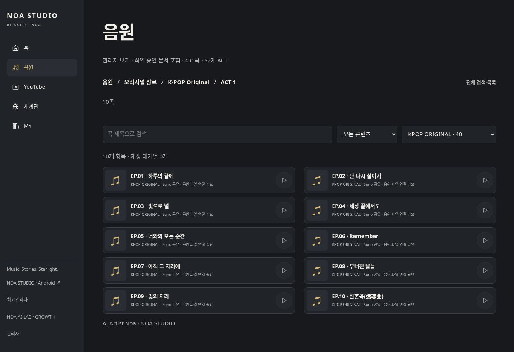
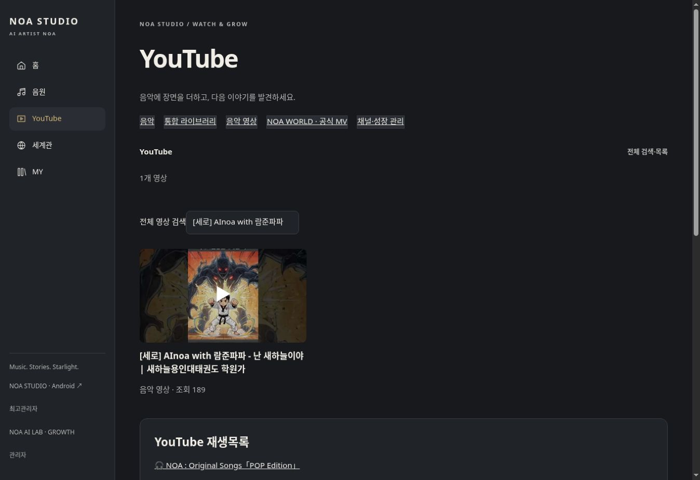

# Suno 표시·플레이어 분리와 원본 자산 이전 — 2026-10-21

정식 사이트 https://noastudio.ai.kr 에 적용했다. 별도 프리뷰, 원본 삭제, 데이터 초기화, Grok 중단은 하지 않았다. 이 보고서는 이번에 검증한 범위와 남은 범위를 구분한다.

## 실제 변경

- 음원 목록의 YouTube 공개 여부 종속 필터를 제거했다. Suno 공유 주소와 검증된 실제 음원 주소를 구분한다. YouTube 비공개 여부로 Suno 곡을 숨기거나 비공개 YouTube ID를 일반 조회에 노출하지 않는다. 문서 자체의 명시적 비공개 설정은 유지한다.
- Suno 목록은 왼쪽 56px 정사각 커버 자리, 가운데 최대 두 줄 제목, 오른쪽 원형 재생 아이콘으로 바꿨다. 확인되지 않은 커버는 음악 아이콘을 쓴다. YouTube 썸네일을 Suno 커버로 대신 쓰지 않는다.
- 음원 화면의 YouTube IFrame API와 영상 플레이어를 제거하고 실제 오디오용 HTMLAudioElement로 분리했다. 공유 URL만 있으면 자체 재생 버튼을 비활성화한다. 원본 파일의 검증 상태·SHA-256·실제 존재·형식을 확인해야 재생 주소가 반환된다.
- 원본 재등록이 기존 정식 곡·플레이리스트 ID를 누락하면 시작 단계와 최종 발행 단계에서 차단한다. 일반 등록과 복구 등록은 같은 MySQL 발행 잠금을 사용해, 작업 사이에 새 복구 판본이 발행되어도 오래된 원본만 최신 목록으로 바꾸지 못하게 했다. 이 보호는 운영 데이터를 수정하지 않고 코드와 격리 DB 검사로 적용했다.
- 가사 조회, 검색, ACT 탐색, 개인 목록의 기존 곡 키를 유지했다. 실제 재생 가능 대기열과 공유 주소만 있는 보관 목록을 구분해, 파일이 없다는 이유로 개인 목록에서 곡 참조를 잃지 않게 했다. 운영 개인 목록 저장 테스트는 실행하지 않았다.
- 홈의 YouTube 전용 곡은 YouTube 화면으로, Suno/음원 곡은 음원 화면으로 연결한다. YouTube 직접 곡 링크는 해당 제목을 표시하되 자동 재생하지 않는다.
- 기존 등록 후 공용 조회에서 빠졌던 YouTube 복구 곡을 웹·Android 공용 읽기 API에 추가했다. 기존 키나 편집값은 바꾸지 않았다. 공개 1곡, 비공개 3곡은 소유자 조회로 제한한다.
- 저장소의 원본 세로/가로 아트와 장르 이미지를 자체 경로로 사용한다. 원본 제공 화면 8장을 대조했다. 장르 격자는 좁은 창에서도 2열, 넓은 화면에서는 4열로 대응한다. 원본 장르 모달·JUKEBOX 전체 동작을 완전 승계했다고 판정하지는 않는다.

## Suno 실제 집계

| 항목 | 결과 |
|---|---:|
| 접근 가능한 원본의 Suno 주소가 있는 고유 곡 | 491 |
| 음원 화면에서 조회되는 Suno 곡 | 491 |
| 위 491곡 중 조회 누락 | 0 |
| 실제 음원 파일 연결·검증 완료 곡 | 0 |
| 공유 주소만 있는 곡 | 491 |
| 원본 Suno 1:1 커버 확보를 확인한 곡 | 0 |
| 원본 오디오 재생 완료로 판정한 곡 | 0 |

491곡이 보인다는 것과 491곡을 자체 재생할 수 있다는 것은 다르다. 실제 오디오를 공유 주소나 추측한 CDN 주소로 만들지 않았다. 기존 Grok의 동적 resolver에는 비공식 Suno 엔드포인트·추측 주소·암호화 음원 처리 경로가 있어 그대로 이식하지 않았다. 실제 파일이나 허용된 공식 연결이 확보되어야 원곡 재생 검증을 이어갈 수 있다.

## 자산 실제 이전

| 항목 | 결과 |
|---|---:|
| `public/`에서 조사한 실제 파일 | 134 |
| 위 파일의 총 크기 | 88,802,341바이트 |
| NOA 자체 경로로 이전·SHA-256 검증한 미디어 | 123 |
| 이전 미디어 총 크기 | 88,520,512바이트 |
| 이미지 | JPEG66 + PNG11 + SVG1 |
| 배경 영상 | MP4 45 |
| 플랫폼 설치 안내·설정 등 원본 보존, 미디어 이전 제외 | 11 |
| 원본 JSON의 외부 이미지 참조 | 54개 URL, 파일 미확보 |

123개 모두 `/noa-assets/` 아래에 원본 바이트 그대로 저장하고 업로드 후 서버 파일을 다시 읽어 체크섬을 검증했다. 재인코딩하지 않았다. 영상45개는 전부 720×1280·24fps·10.041667초이며 오디오 트랙이 없는 소개 영상이다. FFmpeg 전체 디코딩45/45 성공, 실패0. 이를 곡 음원45개로 계산하지 않는다.

외부 이미지 URL 샘플은 HTTP403이었다. 인증 우회 없이 중단했고 다른 URL은 확보된 파일로 계산하지 않았다. Suno 커버의 런타임 캐시도 저장소에서 확보하지 못했다. 손상된 PostgreSQL 저장본과 외부 Grok 저장소 전체를 포함한 ‘자산100% 이전’ 판정은 하지 않는다.

파일별 원본 경로·ID·크기·형식·SHA-256·용도·서버 경로·검증 이력은 [자산 대장](23-asset-inventory.json)에 있다.

## 음악 데이터 보존

이번 작업은 운영 SQL 쓰기를 실행하지 않았다. 이전 [미등록 곡 복구](21-missing-song-recovery.md)의 결과를 유지했다.

| 항목 | 실제 상태 |
|---|---:|
| 원본 고유 곡 | 601 |
| 정식 통합 곡 | 605 — 이전에 복구한 YouTube 곡4 포함 |
| 이번 신규 생성·자동 병합·원본 덮어쓰기 | 각각 0 |
| ACT | 52 |
| 전체 플레이리스트 | 57 |
| 수록 관계 | 1,181 |
| 관계 미식별 | 0 |
| 기존 충돌 검토 곡 | 7 |
| 정보 보완 필요 곡 | 203 |
| 원본 아카이브 | 731/731 바이트 일치, 누락0·차이0 |
| 운영 음악 문서 | 653개, 누락0 / 원본 동일652 / 기존 편집본1 |

원본과 다른 문서는 `playlist:jpop-original:act-1`이다. 이력 revision1→2에서 `thumbCast` female→duet, `confirmed` false→true 및 빈 오디오/가사/Suno 공유 필드 추가를 확인했다. 현재 편집본과 이전 이력을 보존했고 원본으로 되돌리지 않았다. 누가 수정했는지는 이 조회 결과만으로 판정하지 않는다.

공개 API 확인: Suno 곡491, 실제 오디오0, 새 공개 YouTube 곡1이 조회된다. 비공개 신규3곡을 공개하지 않는다. 원곡601·문서653·공용 API 항목 수를 같은 수로 보고하지 않는다.

YouTube는 이전 수집 영상765·재생목록23개를 유지한다. 기존 곡 연결412, 검토226, 일반 홍보 영상127은 별도다. 이번에 유료 생성·업로드·자동 게시를 실행하지 않았다. OAuth/Analytics의 이전 연결 결과는 기존 보고서에 기록되어 있다.

## 검사 및 정식 파일

최종 [배포·검증 실행](https://github.com/rucyjeon79/noa-studio/actions/runs/39483632787)과 [기존 기능 품질 검사](https://github.com/rucyjeon79/noa-studio/actions/runs/39483632783)가 모두 성공했다. 검증 커밋은 `b10c83f60cae46f43484a4f1e8114722dc6fa0b0`이다.

- PHP 문법·Suno 주소/파일/무결성/복구 공개 범위 검사, Node8개 검사, 격리 MySQL의 기존 등록·복구·재실행 검사 통과. 오래된 원본 판본을 시작/최종 발행 양쪽에서 거절하고 복구 곡 유지 및 잠금 해제를 확인했다. 첫 보존 검사에서는 테스트 준비에 운영 전용 메타파일이 없어 실패하여 배포가 차단됐다. 정식 canonical seed를 직접 읽도록 테스트를 보완한 뒤 재검증에 성공했다.
- 320/360/390/430/768/1280/1920px, 18개 경로 × 7개 너비 = 126건, 검출 오류0. 이는 검사 항목 내 결과이며 모든 기기·사용 흐름에 오류가 없다는 뜻은 아니다.
- 실제 흐름12개 통과: 카테고리→장르→ACT→곡, 56px 커버, 가사·공유 링크, 검증되지 않은 재생 비활성, 검색·페이지, 화면 회전 후 선택 유지, ACT52개/음원 없는 ACT 유지, MV 구분, YouTube 직접 곡 링크/자동재생 비활성, 테마·일본어 유지, 공용 복구 조회, 검사한 흐름에서 Grok 도메인 차단 상태의 요청0.
- 정식 HTTP에서 원본 세로 이미지·장르 이미지·배경 영상 샘플3개의 바이트/SHA-256 일치 확인. 전체123개 서버 체크섬 검증은 최초 미디어 배포에서 수행했다.
- 현재 GnuBoard 관리자 인증과 공통 설정 조회 성공. 운영 문서/회원/개인 목록을 테스트용으로 저장하거나 변경하지 않았다.
- ACT 개수가 0으로 표시되던 문제를 실제 사용 중 추가 발견해 수정했다. 음원 주소와 별개인 ACT 문서52개를 탐색 자료로 유지한다. 주소가 없는 ACT도 카드가 남고 수록곡0·원본 보존 안내를 표시한다.

[검증 집계](26-suno-verification.json)에 자동 검사와 보존 결과를 기록했다. 아래는 정식 화면의 실제 카드와 비활성 재생 상태다.

확인 URL:

- https://noastudio.ai.kr/noa-music.php?genre=kpop-original&act=1
- https://noastudio.ai.kr/noa-youtube.php?track=MoJq0RD9q_w
- https://noastudio.ai.kr/noa-catalog-admin.php — 관리자 인증 필요

YouTube 버튼 선택 후 정식 `youtube.com/embed/MoJq0RD9q_w` 플레이어가 열리는 것은 확인했다. 이 사실만으로 영상 스트리밍·소리 재생 성공으로 판정하지 않는다. 검증 브라우저의 외부 썸네일 로딩 실패와 초기 버튼 무반응도 관측했고, 새 문서에서 버튼→공식 플레이어 열림은 재확인했다. 실제 측정도 duration55초·currentTime0·readyState0으로, 외부 영상 스트리밍은 검증 미완료다. 썸네일은 후속 수정에서 기존 공식 API 캐시를 카드와 연결하고 캐시를24시간마다 갱신하도록 보완했다. 최종 카드 이미지480×360px 로딩 성공, 미리보기 자동재생 비활성, 버튼 선택 후 공식 플레이어 열림을 재검증했다. 영상/오디오 스트림 프록시를 만들지 않았다.

서버에서 실제 변경한 프로그램/스타일13개는 모두 저장소 파일과 배포 후 SHA-256이 일치했다. 파일별 크기·해시는 검증 집계에 포함했다:

- `noa-music.php`, `noa-music.css`, `noa-browse.js`, `noa-playlists.js`
- `noa-home.js`, `noa-ui.css`, `noa-youtube.php`, `noa2.php`
- `noa-bridge/sound-core.php`, `noa-bridge/catalog.php`
- `noa-bridge/youtube-thumbnail.php`, `noa-bridge/catalog-store.php`, `noa-bridge/catalog-recovery.php`

추가 원본 미디어123개는 자산 대장의 서버 경로를 따른다. GnuBoard 코어·회원·게시글·설정 DB를 수정하지 않았다. 배포 로그에서 보호 대상 코어10개 해시 유지와 SQL 쓰기 없음이 확인됐다.

## 미완료·외부 제약

- 원본 음원과 Suno 1:1 커버의 실제 파일 확보·자체 원곡 재생·청취 검증.
- 원본 전체 JUKEBOX, 장르 모달, ACT 소설형 세계관, MY 즐겨찾기의 전체 대체.
- 그누보드 전체 스킨의 로그인한 쓰기·첨부·댓글·회원 변경 시나리오. 공개 조회 검사는 전체 쓰기 검증을 대신하지 않는다.
- OpenAI·영상·립싱크 생성 서비스 연결과 실제 제작. 테스트 엔진 코드나 배경 영상의 존재를 실제 생성 성공으로 계산하지 않는다.
- Android 원래 서명키 연결·실제 기기·원곡·잠금 화면 검사. 이번에는 APK를 교체하지 않았다. 이전 에뮬레이터 PCM 테스트는 원곡/실기기 성공이 아니다.
- 손상된 SQL 전용 데이터, 원격 미확보 이미지, 외부 임시 캐시 등 접근하지 못한 자료.

Grok 완전 대체·삭제 가능 판정은 아직 불가다. 원본 Grok 앱과 개발 소스를 유지한다.
