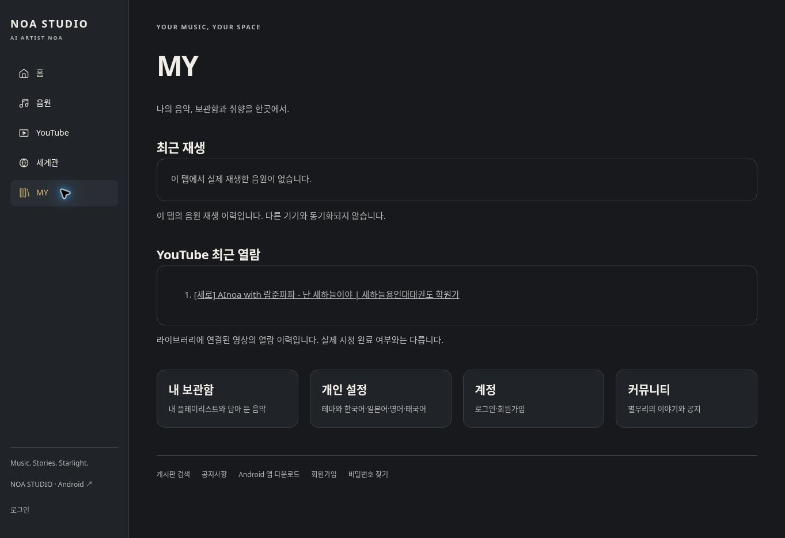

# MY 최근 이력 연결 수정 — 2026-10-21 (한국시간)

정식 사이트에 적용한 기존 기능 수정이다. 신규 서비스 확장, 운영 DB 쓰기, 원본 삭제, 별도 프리뷰 생성은 하지 않았다.

## 실제 수정

- MY의 기존 단일 `noa-last-song` 링크는 항상 음원 화면으로 연결했다. 이를 현재 탭의 음원 재생 이력과 YouTube 열람 이력으로 구분했다.
- 실제 오디오의 `playing` 이벤트만 음원 재생 이력으로 기록한다. 선택·로딩·실패·Suno 공유 링크는 재생 완료로 기록하지 않는다.
- YouTube 버튼으로 공식 플레이어를 연 경우에는 영상 열람으로 기록한다. 시청 완료 또는 실제 스트리밍 성공으로 판정하지 않는다.
- 최대 40개 참조를 탭의 sessionStorage에 보관하며, 같은 매체·같은 고유 키만 중복 제거한다. 화면별 최대 20개를 표시한다. 곡 제목·가사·토큰은 이력 저장소에 복사하지 않는다.
- MY를 열 때 현재 접근 가능한 공용 음악 API로 제목과 재생 가능 여부를 다시 확인한다. 조회되지 않는 항목과 검증되지 않은 음원은 표시하지 않는다. YouTube 이력은 라이브러리에 연결된 영상만 표시한다.
- 이 탭 한정 이력이며 계정·다른 기기와 동기화되지 않는다고 화면에 안내했다. 기존 `noa-last-song`, 곡·회원·개인 플레이리스트는 지우지 않았다.

## 정식 서버 파일

| 파일 | 결과 |
|---|---|
| `/noa-history.js` | 신규: 제한된 탭 이력과 현재 공개 목록 확인 |
| `/noa-my.php` | 수정: 음원/영상 이력 분리, 올바른 복귀 링크 |
| `/noa-music.php` | 수정: 실제 오디오 재생 시작 이벤트 연결 |
| `/noa-youtube.js` | 수정: 공식 플레이어 열람 이벤트 연결 |
| `/noa-youtube.php` | 수정: 이력 스크립트 연결 및 변경 JS 캐시 버전 |

5개 모두 배포 후 서버 재읽기 SHA-256이 소스와 일치했다. 배포 로그에서 그누보드 보호 파일10개 보존 및 SQL 쓰기 미실행을 확인했다.

## 검증

코드 커밋: `69bad46053362684abe29c7028b400d40c2d4fd2`

- [정식 배포·반응형·실제 흐름 검사](https://github.com/rucyjeon79/noa-studio/actions/runs/39490037170)
- [기존 기능 품질 검사](https://github.com/rucyjeon79/noa-studio/actions/runs/39490042680)
- Node 검사11개: 재생·대기열·위치 저장·실패 상태·15장르·ACT·페이지·YouTube 백그라운드·이력 손상/상한/중복/현재 접근 권한·복귀 경로 검사.
- PHP 문법, 기존 YouTube/Suno 검증, 격리 MySQL 등록·복구·재실행·발행 보존 검사.
- 실제 정식 사이트에서 공개 복구곡의 영상 버튼 → MY의 YouTube 열람 목록 표시 확인. 음원 최근 재생 목록에는 추가되지 않았다. 자동 Playwright 검사에서 이 링크 클릭 후 같은 영상 카드로 복귀하며 자동 재생하지 않는 것도 확인했다.
- 실제 사용 흐름13개 통과. 반응형은 18경로 × 6너비(320/360/430/768/1280/1920) = 108건 통과, 해당 검사 오류0. 별도의 390px·18경로 작업은 보고 시점 실행 중이므로 성공에 포함하지 않았다. 실제 사용 흐름13개는 390px에서 통과했다. 상세 결과는 [검사 집계](30-my-history-verification.json)에 기록한다. 판정은 해당 자동 검사 범위에 한정한다.

정상 확인 URL: https://noastudio.ai.kr/noa-my.php

## 데이터 및 남은 항목

이번 변경의 신규 곡 생성·병합·SQL 수정은 각각0건이다. 이전 확인된 통합곡605, ACT52, 플레이리스트57의 집계를 다시 센 작업은 아니다. 이전 데이터·자산 보존 검증은 [기존 보고서](24-suno-assets-recovery.md)를 유지한다.

- 실제 원곡 파일 연결0 상태이므로, 실제 원곡을 통한 최근 음원 재생의 운영 검증은 미완료다. 이벤트 동작은 합성 오디오 시험으로 확인했고 원곡 성공으로 계산하지 않는다.
- 즐겨찾기·계정 간 재생 이력 동기화는 이번에 구현하지 않았다.
- 기존 개인정보 처리방침과 이용약관에 그누보드 기본 본문 안내가 남아 있는 것을 재확인했다. 운영자 정보 및 실제 서비스 처리 내용에 맞춘 본문 확정이 필요하다. 임의 법률 문구로 덮어쓰지 않았다.
- 원본 Suno 커버, 전체 JUKEBOX/장르 모달 승계, AI 실제 생성 인증, Android 기존 서명·실기기 및 원곡 백그라운드 검증은 기존 미완료 상태다.
