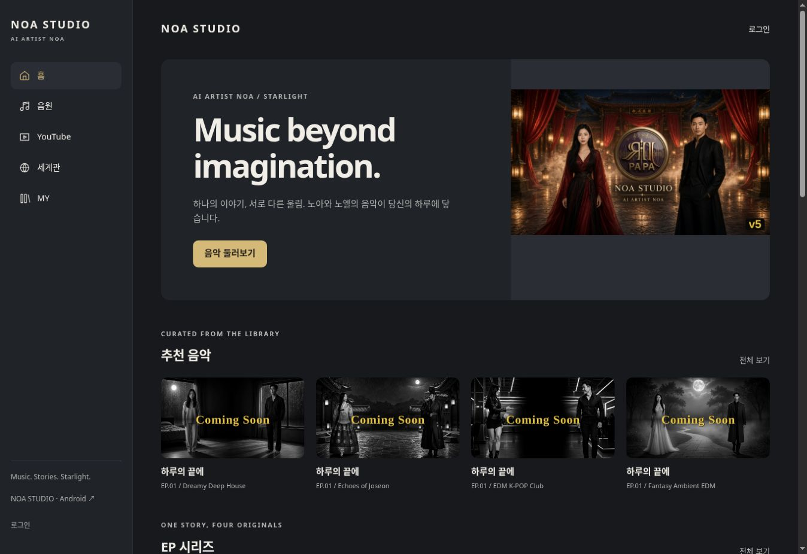
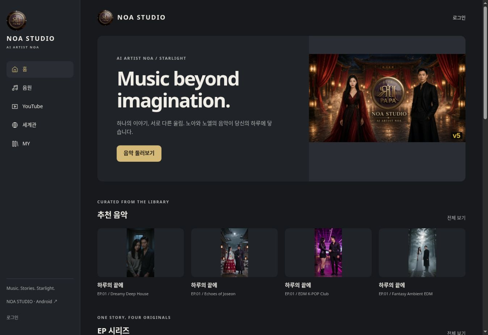
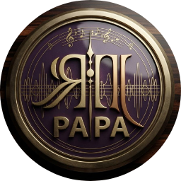
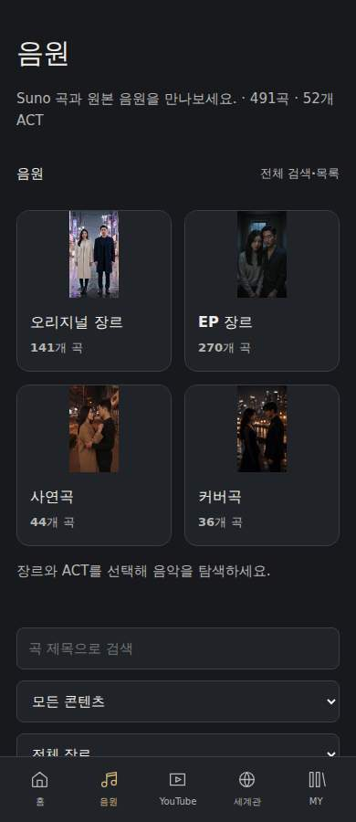

# 최종 지시서 반영 — 심볼·공개 이미지·Android 경로·ACT 조회 (2026-10-21)

사용자가 첨부한 `NOA_STUDIO_WORK_FINAL_COMPLETE.txt`를 읽고, 마지막 배포 이후 P0 오류를 실제 수정했다. 본 문서는 전체 지시서 완료 선언이 아니라 이번 적용과 현재 남은 범위를 기록한다. 별도 프리뷰·원본 삭제·운영 DB 쓰기·Grok 앱 중단은 하지 않았다.

## 실제 오류와 수정

| 위치·재현 | 확인한 원인 | 수정 |
|---|---|---|
| 웹 헤더 / 설치 아이콘 | 원본 Grok 헤더는 `/papa-logo.png`인데 웹에는 텍스트만 있고 PWA·Android는 별도 N 심볼 | 기존 PAPA 원본을 웹 헤더·파비콘·Apple touch icon·PWA manifest·Android 런처/적응형 아이콘·시작 화면 리소스로 연결 |
| 홈의 공개 곡 카드16개 | 장르 fallback이 Coming Soon 문구가 포함된 `public/coming/` 이미지를 사용 | 원본 Grok의 `SPLASH_FILE` 장르15종 매핑을 그대로 승계. 문구 없는 기존 포스터를 장르 대표 이미지로 표시. 개별 Suno 커버 확보로 계산하지 않음 |
| Android 음원 메뉴 | 공용 음악 API 항목을 매체별 필터 없이 모두 사용 | Suno/실제 음원 또는 ACT만 음원 탐색에 사용. YouTube 전용 곡은 YouTube 메뉴에서 조회 |
| Android 곡 상세의 영상 버튼 | YouTube ID가 있는데도 `noa-music.php?track=곡키`로 이동 | `noa-youtube.php?track=영상ID`로 이동. Suno 곡 상세는 별도 링크로 유지 |
| 공용 음악 API의 ACT | Suno/오디오/공개 YouTube 재생 주소가 없는 ACT 메타데이터를 필터링 | 문서 자체의 공개 범위 검증 후 컬렉션 정보는 유지. 없는 재생 URL 생성 및 비공개 YouTube ID 공개는 하지 않음 |
| MY 최근 기록 링크 | 작은 터치 영역·긴 제목·기본 밑줄 | 최소44px 터치 영역, 긴 텍스트 줄바꿈, 평상시 밑줄 제거·hover/키보드 초점 유지 |

PWA의 기존 `id`, `start_url`, scope는 그대로 유지했다. 기존 서비스 워커는 인증 페이지·회원 데이터·음악을 캐시하지 않고 자산 캐시도 만들지 않는다. 현재 manifest와 아이콘 URL의 버전을 갱신했다. 이미 설치된 사용자의 모든 PWA 아이콘이 OS에서 갱신됐다는 판정은 하지 않는다. Android 시작 화면은 리소스 연결이며 스플래시 프레임을 별도로 촬영해 검증하지 않았다.

## 정식 배포와 검증

검증 근거는 [통합 집계](35-final-p0-verification.json)에 기록한다.

- 브랜드 코드: `2e08fc23cc42651a477ccd2770e655f9b211aa8d`
- 공개 이미지 코드: `cf9e7b1759bcf75ed092f5da5d83f17b46f6d40f`
- ACT/Android 경로 코드: `95e66681abad8fea87ae56cec46366ac00ab8c1e`
- [최종 정식 배포 검사](https://github.com/rucyjeon79/noa-studio/actions/runs/39496305116)
- [Android 심볼·영상 경로 검사](https://github.com/rucyjeon79/noa-studio/actions/runs/39496304882)
- Android ACT 수록곡 분리 추가 코드: `719901ce642815a721ea51a09d79f026af7281c9`
- Android 검사 동기화 수정: `912358c6e17053f0f15d8ea9267df47862cbae9e`
- [최종 Android 전체52ACT·수록곡 검사](https://github.com/rucyjeon79/noa-studio/actions/runs/39497940988)

원본 심볼 파일은 새로 생성하거나 재가공하지 않았다. 웹 아이콘192/512의 운영 HTTP 바이트 해시와 원본을 비교한다. Android는 원본512 PNG를 빌드 리소스에 그대로 복사하고, 설치된 패키지 리소스의 SHA-256 `7a6b94a09ba10b951f15b6779c7d30c74e1ee44bdd5e2a9df7e6a676dd9f02cb` 및 AdaptiveIconDrawable을 에뮬레이터에서 검증했다.

이전 MY 배포의 390px 작업(39490037170)은 마지막에18경로 모두 연결 시간 초과로 실패했다. 이전 보고서는 대기 상태였으나 실패 결과가 확정됐음을 이 문서에 명시한다. 이를 성공으로 바꾸지 않았다. 뒤이은 브랜드 배포(39495528759)와 공개 이미지 배포(39495864141)의 동일126검사는 390px를 포함해 통과했다. 최종 ACT 변경의 동일126검사와 실제 흐름16개도 통과했다.

## 실제 완료 검사와 서버 파일

최종 웹 배포의 PHP·격리 MySQL·정식 HTTP·Playwright 검사 모두 통과했다. 18경로 × 7너비 = 126건, 검사 범위 오류0. 실제 사용자 흐름16개와 Node 회귀11개 통과. 전 기능·모든 기기의 무오류 판정이 아니다.

정식 공용 API를 브라우저로 다시 조회해 544항목 = 곡492 + ACT52, Suno 곡491, 원곡 파일0, 1:1 커버0을 확인했다. 이는 관리자 정식 등록605곡 전체 집계와 구분한다.

이번에 변경된 정식 서버 파일24개 모두 최종 소스의 크기·SHA-256이 일치한다. 일부 PHP 수정은 공통 스크립트/CSS의 캐시 버전 및 브랜드 스크립트 연결이다. 그누보드 보호 파일10개가 같고 SQL 쓰기는0건이었다.

| 서버 파일 | 크기(바이트) |
|---|---:|
| `/extend/noa.design.php` | 966 |
| `/noa-ai-lab.php` | 10053 |
| `/noa-brand.js` | 1239 |
| `/noa-bridge/catalog.php` | 3277 |
| `/noa-browse.js` | 8907 |
| `/noa-catalog-admin.php` | 11013 |
| `/noa-catalog.php` | 9149 |
| `/noa-editor.php` | 13652 |
| `/noa-home.js` | 3734 |
| `/noa-library.php` | 6506 |
| `/noa-manifest.json` | 553 |
| `/noa-music.php` | 19997 |
| `/noa-my.php` | 3232 |
| `/noa-recovery.php` | 4831 |
| `/noa-settings.php` | 989 |
| `/noa-theme-admin.php` | 4593 |
| `/noa-ui.css` | 20141 |
| `/noa-ui.js` | 12315 |
| `/noa-youtube-admin.php` | 4143 |
| `/noa-youtube.php` | 6843 |
| `/noa2.php` | 6137 |
| `/theme/noa_studio/head.php` | 562 |
| `/theme/noa_studio/mobile/head.php` | 562 |
| `/theme/noa_studio/skin-bridge.php` | 1099 |

Android 최종 빌드·lint·설치·실사용 검사2개가 통과했다. 원본 아이콘 바이트, ACT52개, K-POP ACT1의 수록곡10개(컬렉션 문서 중복 없음), 가사·테마·일본어, 영상 버튼의 실제 YouTube 경로를 확인했다. 합성 PCM은 전면1,025ms → 배경4,572ms → 화면 꺼짐7,269ms로 진행했고 미디어 알림·세션·제어를 확인했다. 이는 원곡 또는 실제 휴대폰 재생 검증이 아니다.

추가 ACT 검사 첫 실행(39497336675)은 ACT 검증 후 화면이 재생성되는 사이 오래된 설정 버튼을 참조해 UiAutomator StaleObjectException으로 실패했다. 새 라이브러리 준비 상태를 기다린 뒤 버튼을 다시 찾도록 검사 코드를 고쳤고 위 최종 실행에서 통과했다. 실패를 성공으로 바꾸거나 무시하지 않았다.

[후보 APK 빌드 결과](https://github.com/rucyjeon79/noa-studio/actions/runs/39497940988)의 `NOA-STUDIO-Android-APK` 아티팩트를 보존했다. 정식 다운로드는 기존 서명 빌드13이며 후보 APK로 교체하지 않았다. 실제 휴대폰의 기존 앱을 삭제하거나 사용자 데이터를 초기화하지 않았다.

## 수정 전후 정식 화면

수정 전: 헤더 심볼 없음, 공개 곡에 Coming Soon 이미지.

수정 후: 원본 심볼, 공개 곡에 기존 장르 포스터. 세로 원본 이미지는 얼굴·전신을 임의 자르지 않도록 contain으로 표시한다.

아래는 에뮬레이터에 실제 설치된 패키지의 적응형 런처 아이콘을 렌더링한 결과다. 실제 휴대폰 홈 화면 스크린샷과 구분한다.

390px 정식 음원 탐색 화면도 같은 배포에서 확인했다.

## 데이터·자산 보존과 현재 범위

- 이번 신규 곡 생성·자동 병합·기존 곡/회원/설정 수정은0건이다. 이전 정식 집계605곡·52ACT·57플레이리스트·1,181수록 관계는 이번에 다시 DB 전체 대조한 숫자가 아니다. 기존 [데이터·자산 검증](24-suno-assets-recovery.md)을 유지한다.
- 기존 원본 미디어123개/88,520,512바이트 이전 결과를 재사용했다. 이번 심볼·포스터 연결을 미디어 신규 생성/추가 확보로 중복 계산하지 않는다.
- Suno 곡491의 공유 링크와 실제 오디오는 계속 분리한다. 원곡 파일 검증·연결0, 실제 원곡 재생 성공0, 1:1 Suno 커버 확보0 상태다. 장르 대표 포스터16개 표시를 곡 커버16개 확보로 보고하지 않는다.
- Android APK 빌드·lint·에뮬레이터 설치, 원본 심볼, 가사·테마·언어, 영상 버튼의 실제 WebView 경로, 합성 PCM의 백그라운드/화면 꺼짐·미디어 제어를 검증한다. 합성 오디오 검사는 기존 원곡 성공이 아니다.
- 정식 APK 다운로드는 기존 빌드13을 유지한다. 원래 서명키가 없어 업데이트용 정식 APK 교체는 하지 않았다. 자동 debug APK 게시를 막고, 명시적인 게시 요청에도 기존 서명 일치 검사를 통과해야 배포하도록 유지했다. 실제 휴대폰 설치·PWA 설치 갱신은 미완료다.

## 전체 지시서 잔여 상태

| 영역 | 현재 판정·잔여 이유 |
|---|---|
| 기존 음악/가사/ACT/플리 | 기존605곡 통합 결과 유지. 손상된 저장본·미수집 SQL 전체까지100% 복구 판정 불가 |
| 원본 이미지/영상 | 저장소 미디어123개 이전 검증 완료. 외부 이미지54참조와 Suno 캐시/1:1커버는 미확보 |
| Suno 자체 재생/프리미엄 오디오 | 원곡 파일이 없어 운영 원곡 청취·분석·최적화 검증 불가. FFmpeg 격리 시험과 구분 |
| YouTube | 공식 플레이어·공개 썸네일·직접 링크 검사. 실제 스트리밍 완주·전체765영상 정상 재생 판정 아님 |
| 심볼 | 웹/PWA 리소스·에뮬레이터 아이콘 검증. 기존 설치 앱 업데이트와 실기기 표시 미완료 |
| 세로 풀스크린/원본 JUKEBOX/장르 모달 | 원본 자산 및 반응형 격자 부분 승계. 전체 UX 1:1 승계 미완료 |
| 4개 언어 | 한국어·일본어 및 테마 유지 일부 흐름 검증. 영어·태국어 전체 화면·기기 조합 실사용은 미완료 |
| MY | 탭 이력·기존 개인 플리 제공. 즐겨찾기·계정 간 이력 동기화 미완료 |
| 세계관 | 기존 캐릭터·공식 MV 제공. ACT별 소설형 스토리 완성 미완료 |
| 그누보드 | 기존 NOA 테마/공통 UI 유지, 코어 보호. 기본 스킨 위임 잔존, 인증 후 글/댓글/첨부 전체 실사용 미완료 |
| 개인정보처리방침/약관 | 기본 본문 안내 잔존. 운영자·실제 처리 내용에 따른 확정 문구 필요 |
| AI LAB | 실제 OpenAI·영상/립싱크 생성 인증 및 원곡 작업 성공 미확인. 유료 생성·YouTube 게시 실행0, 자동 게시 비활성 유지 |
| Android | 후보 APK·에뮬레이터 검증. 기존 서명키와 실제 기기·원곡 백그라운드 검증 필요 |
| Grok 독립/삭제 | 검사한 사용자 흐름은 Grok 도메인 차단 상태에서 동작. 전체 자산·Node 기능·AI·실기기·백업/복원 완료가 아니므로 Grok 삭제 불가 |

기존 Grok 전체 기능의 정확한 총수는 이번 제한된 비교로 확정하지 않았다. 확인하지 않은 영역을 정상 승계로 분류하지 않는다. 전체 지시서를 완료 처리하지 않는다.
