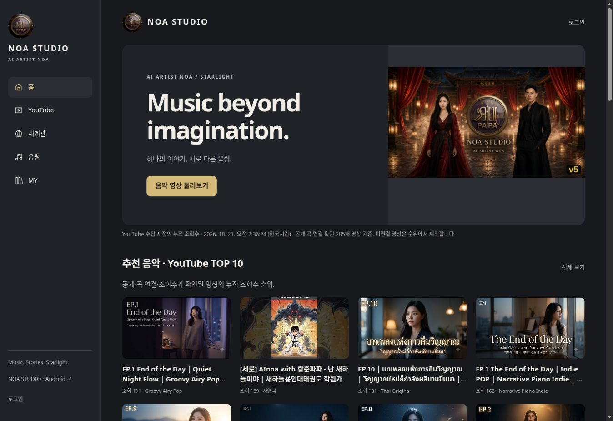
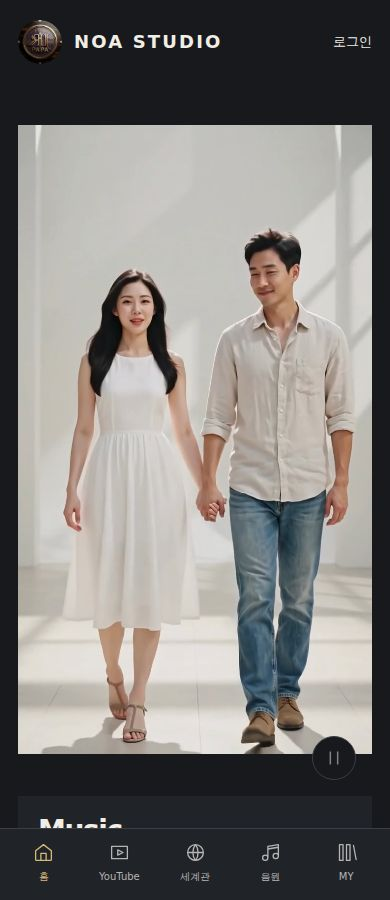

# 원본 움직이는 메인·조회수 홈·메뉴 정리 — 2026-10-21

첨부한 `NOA_STUDIO_WORK_DIRECTIVE_FINAL.txt`의 마지막 지시를 적용했다. 이번 완료 범위는 홈 구성·순위 읽기·원본 인트로 연결·메뉴 순서·YouTube 목록 필터다. 전체 지시서 완료 선언이 아니다. 정식 도메인에 적용했으며 프리뷰, 운영 SQL 쓰기, 원본 삭제, Grok 중단은 하지 않았다.

## 실제 변경과 근거

| 위치 | 기존 문제 | 이번 변경 |
|---|---|---|
| 홈 추천 | 목록의 앞부분을 조회수와 무관하게 노출 | 저장된 공식 수집 자료 중 공개·재생 허용·기존 곡 연결·조회수가 확인된 영상 TOP10. 수집 시점과 제외 범위 표시 |
| EP | 단순 앞부분 표시 | 실제 EP 번호가 있는 각 장르에서 조회수 1위 한 곡. 없는 장르를 임의 채우지 않음 |
| 사연곡·커버곡 | 별도 순위 기준 불명확 | 확인된 장르와 곡 연결을 기준으로 TOP10. 10개 미만이면 실제 개수, 0개면 설명 표시 |
| 플레이리스트 | ACT 문서의 단순 나열 | 공개 ‘연속듣기’ 목록과 실제 수록 관계로 조회수 합산. ACT 합본은 개별 곡 연결이 없어도 수록 영상으로 집계. 공식 재생목록 조회수라고 표시하지 않음 |
| 홈 순서 | 추가 섹션·순서 불일치 | 히어로 → 추천 → EP → 사연곡 → 커버곡 → 플레이리스트 → 세계관 → 음악 컬렉션 → 커뮤니티 |
| 움직이는 메인 | 별도 정지 이미지 | 원본 `SPLASH_FILE`의 15장르×3종 중 하나만 선택. 실제 자체 서버 MP4, 무음·비반복. 원본 가로 아트 유지 |
| 자동 재생 접근성 | 미적용 | 동작 줄이기·20초 재진입 제한 존중. 재생/일시정지 아이콘, 회전 시 일시정지·같은 클립/위치 보존 |
| 전역 메뉴 | 이전 순서 | 홈 / YouTube / 세계관 / 음원 / MY. 웹 양쪽 메뉴·Android 모두 동일 |
| YouTube 선택 | 홈에서 추가 선택 필요 | 명시적인 홈 영상 선택은 해당 내부 공식 플레이어를 즉시 연다. 이전 직접 링크는 자동 재생하지 않음 |
| 재생목록 상세 | 전체 채널 카드가 섞임 | 선택한 공개 재생목록의 수록 영상만 기존 순서로 표시. 공개 확인 없는 목록은 404 |

실제 YouTube 썸네일을 사용하며 Coming Soon·장르 포스터를 곡 커버로 대체하지 않는다. 첫 확인에서 썸네일 1건의 일시 실패가 있었고 같은 공식 썸네일 경로 재요청에서 480px 이미지를 확인했다. 홈을 다시 열어 TOP10 모두 480px 로딩을 확인했다. 일시 오류를 위한 잘못된 대체 이미지를 추가하지 않았다.

## 순위의 실제 범위

수집 완료 시점은 **2026-10-21 02:36:24 한국시간**이다. 이번 화면 변경에서 YouTube API 전체 재수집을 실행하지 않았다. 조회수는 실시간 값이 아니다.

개별 곡 연결이 확인된 공개·재생 허용 영상 285개를 대상으로 추천10, EP 대표11장르, 사연곡1, 커버곡0을 산출했다. 커버곡0은 채널에 커버 영상이 없다는 뜻이 아니라 현재 곡 연결과 분류 조건을 충족한 공개 영상이 없다는 뜻이다. 검토 중 영상에 제목만으로 장르나 곡을 자동 할당하지 않았다.

운영 조회 결과 공개 연속듣기 목록은 **1개**, 집계 수록 영상33개, 제외16개, 저장된 조회수 합계**1,550**이다. 1개를 10개로 늘려 표시하지 않았다.

연속듣기는 수록 영상의 누적 조회수를 중복 영상 ID 없이 합산한다. 개별 곡 연결과 독립적으로 채널의 공개·재생 허용·조회수 확인 수록 영상을 집계한다. 이 목록에는 ACT 합본도 있다. 목록 간 같은 영상의 중복은 각 목록의 지표에 포함되므로 채널 전체 고유 조회수와 다르다. 일부 공개·비공개·재생 불가·조회수 미제공·다른 채널 영상은 순위에서 제외한다. 목록을 10개까지 임의 생성하지 않았다.

## 검증과 실패 이력

최초 실제 흐름 검사는 원본 MP4 재생 단계에서 실패했다. 진단 결과 CI Chromium의 `DEMUXER_ERROR_NO_SUPPORTED_STREAMS`로 H.264 디코더를 지원하지 않았다. 실제 Chrome에서는 같은 원본 MP4가 720px·readyState4·재생 시간 진행으로 확인됐다. 원본을 재인코딩하거나 실패를 지우지 않고 검사 브라우저를 공식 Chrome으로 바꿨다.

초기 126개 반응형 검사는 통과했지만 홈 카드 비동기 로딩 전 측정이 포함돼 있었다. 홈 집계 준비 완료를 기다리고 카드 크기를 측정하도록 보강했다. 최종 결과는 [검증 데이터](38-home-verification.json)에 기록한다.

공식 Chrome 390px에서 실제 재생 시간이 진행된 원본 인트로 프레임:

## 데이터·원본 보존

이번 신규 곡 생성·자동 병합·곡/회원/설정 덮어쓰기·운영 SQL 쓰기는 각각 0건이다. 기존 통합 결과는 원본601곡 → 정식605곡, ACT52, 플레이리스트57, 수록 관계1,181이다. 이는 이번에 전체 DB를 다시 대조한 숫자가 아니며 [이전 원본 검증](24-suno-assets-recovery.md)과 [미등록 곡 복구](21-missing-song-recovery.md)를 유지한다. 공개 읽기 API544항목은 곡492+ACT52이며 전체 등록605곡과 구분한다.

기존 원본 미디어123개/88,520,512바이트, 소개 MP4 45개를 그대로 사용한다. 이번 화면 연결을 신규 자산 확보로 중복 계산하지 않는다. 자산별 원본·크기·해상도·체크섬·이전 상태는 [기존 대장](23-asset-inventory.json)에 있다. 외부 이미지54개는 URL만 확보된 상태이며 Suno 1:1 커버 확보0, 원곡 파일0, 운영 원곡 재생 성공0이다.

## 남은 실제 작업

| 영역 | 현 상태와 미완료 이유 |
|---|---|
| 전체 Grok 1:1 | 기존 소스·데이터·자산 및 검사한 소비자 흐름 대조. 숨은 메뉴·관리자 전체·손상 저장본까지 정확한 기능 총수는 미확인 |
| 장르 상단 | 기존15장르/4분류 보존. ORIGINAL/COLLECTION/OTHER GENRE 세 그룹을 모두 펼치는 최신 구조는 미완료 |
| JUKEBOX | 검증된 실제 오디오만 대기열 대상으로 하는 기반 유지. 원본 JUKEBOX 전체 이식·분석값 원형 시각화 미완료 |
| 마스터링·다운로드 | FFmpeg 격리 검사와 원곡 처리는 별개. 원곡 파일 및 운영 작업자 연결이 없어 실곡 LUFS·MP3 캐시·WAV 결과0. Intensity50 동등 알고리즘 검증 미완료 |
| 세계관 | 원본 NOA/NOEL·공식 MV 링크 유지. ACT별 확정 소설·챕터·에필로그와 MV 설명 구조 미완료 |
| 커뮤니티 | 기존 공개 게시판 이동 유지. 실시간 알림·인라인 답글·대댓글 기능 미완료 |
| 그누보드 | 테마 공통 UI·코어 보호 유지. 기본 스킨 위임 잔존. 로그인 후 쓰기·첨부·권한 전체 실사용 미검증 |
| 다국어 | 기존 테마·언어 설정 보존. 홈 새 순위 안내의 영어/일본어/태국어 전체 번역 미완료 |
| Android/PWA | 후보 빌드·에뮬레이터 검사와 실제 휴대폰을 구분. 운영 원래 서명키·실기기 원곡 재생·설치 캐시 갱신 미검증. 기존 운영 빌드13 유지 |
| AI LAB·성장 | 기존 OAuth/Analytics 연결 기록 유지. 이번 토큰 재인증·신규 분석 수집·유료 생성·업로드0. OpenAI/영상 공급자·실곡 작업 서버 실행 미완료. 자동 게시 OFF |
| 완전 독립 | 이번 검사 흐름의 Grok 호출 차단 검증과 전체 독립은 다름. 외부 이미지·Suno 원곡/커버·AI·전체 백업 복원 미완료. Grok 삭제하지 않음 |

개별 ACT·플레이리스트 수록곡 집계는 기존 통합 자료를 보존하며 이번 순위 화면 작업에서 등록 완료 수를 부풀리지 않았다. 기존 [ACT/플리 집계](21-missing-song-recovery.md)와 연결 데이터가 기준이다.

## 실제 변경된 서버 파일

이번 변경은 정식 서버 파일22개에 반영됐다. 아래는 마지막 집계 수정을 포함한 최종 크기·SHA-256이며, 업로드 후 서버 파일 재읽기로 비교했다. 그누보드 보호 파일10개는 배포 전후 일치한다.

| 서버 경로 | 바이트 | SHA-256 |
|---|---:|---|
| /noa-bridge/home-core.php | 4227 | `314b47712db85e6d49dc16329a6bd1eb751a8ed8b39b822dda204d7625a7b276` |
| /noa-bridge/home.php | 1563 | `9bcaa4a3dd2583a204c2497c45e21d0de795aa4176d8173fdd9f01d1822d5df7` |
| /noa-hero.js | 2809 | `214047cc6b9815cfc624ab2e19a97df0abbb1aa75eef8b43faab16813e7a93a1` |
| /noa-recovery.php | 4829 | `ab866fc132908f455eb97e6ec85c5c3615ad3dddd9a2d11c15f83fcdd0470ad5` |
| /noa-home.js | 3327 | `f47c19724a566cd8594c1db674c4aed47057bcf4694232308c6eb36076548b94` |
| /noa-ui.css | 21860 | `6b5ee67e96b4c491a5fd80f83f98110b1830ec11343eb13eb826e5eb089134b2` |
| /noa-ui.js | 12471 | `6694813c8de5be253c2ecfcccad3bd7a690a5f64cbf4d36bdf8b5f8a94cfc412` |
| /noa-ai-lab.php | 10051 | `c06db08c02bfea52e8e7413d4a297633708afec59fc54b30056cef52a19482c7` |
| /noa-catalog-admin.php | 11011 | `de542b33e5016d66559af7dc6b11fcf5384746bc3c55d6bf700a053d2e1d969f` |
| /noa-catalog.php | 9147 | `89893bdf3d0e9c406763110ca538a05ba36079b2380d0c06f413ede926906a1d` |
| /extend/noa.design.php | 964 | `dcb8fd7603f706b48a713d1de6ffac6a1378628cfc385cedbb7c09ece84c1c60` |
| /noa-editor.php | 13650 | `bde0f5199a26ca3b754bcc0c71e89b921e4170cb1bf32968a0c5fe4f74034eb4` |
| /noa-library.php | 6504 | `c8add257d775aa4ce218b7dcad02e517a786f4483292646e01d8ee35e24ace2c` |
| /noa-music.php | 19995 | `9b01737a32d7207e262a9aea4e13b9a4d8317b709438155e7fd0adeb9988e497` |
| /noa-my.php | 3230 | `e24ab096ad5a9fe528c15adaa9ea4af83895db0181a888d7195b3ba1931db679` |
| /noa-settings.php | 987 | `ea533c8c6bd17302b01ef524a75d4b3943cd7e29bfd9213b43b2121d9a9c7c8a` |
| /noa-theme-admin.php | 4591 | `6826f404b785d8df4ecc6047cb0cebf254f92ff68b190319c2001feabfa1b2d8` |
| /noa-youtube-admin.php | 4141 | `d390e7438fba076d5b26c2f6b651ca5b01d3fe0731546d94894ff68f27a108d9` |
| /noa-youtube.php | 7673 | `ac4fff65e20cffe45c2fc1fd894666971ce798d51b4b8192a4fa320512bea373` |
| /noa2.php | 7352 | `00aae238654aa158b94c2ba57ada2c8a830f9452659f094675a6f927c0ea1a88` |
| /theme/noa_studio/head.php | 560 | `3c06f6fb2b3712a51a1e2f660ba02d6c3c7b2e0bc302b07463f338b081b1274c` |
| /theme/noa_studio/mobile/head.php | 560 | `3c06f6fb2b3712a51a1e2f660ba02d6c3c7b2e0bc302b07463f338b081b1274c` |

## 최종 실행 결과

- 구현 커밋 `97db8c2f63f1be03e3b860c4adfa53d7eb4af48a`, 재생 진단 `d45b74809643311d70c2853c05ed602b3f782176`, 최종 적용 `3d009bcde411af7dde545fbacb6b34367cece8b4`.
- [최종 정식 배포·검증](https://github.com/rucyjeon79/noa-studio/actions/runs/39510045783): PHP·Node·격리 MySQL 검사 후 정식 SFTP 배포 성공. 준비된 홈 카드를 포함한18경로×7너비=126검사, 검사 범위 오류0. 화면 폭320/360/390/430/768/1280/1920px.
- 같은 실행의 공식 Chrome 실제 흐름19개 성공. 원본 세로 영상의 시간 진행·무음·비반복, 가로 전환 일시정지, 같은 영상 유지, 홈→정확한 공식 플레이어, 33개 연속듣기 멤버 내부 경로, 기존491Suno/52ACT/가사/56px목록/검색/페이지 이동/MY/테마·일본어 확인. 검사한 흐름의 Grok 요청0. YouTube 전체 영상 스트리밍 완주 성공 수로 계산하지 않음.
- [엔진 품질 검사](https://github.com/rucyjeon79/noa-studio/actions/runs/39510045806): 성공. 운영 원곡 생성·마스터링 성공과 구분.
- [Android 빌드·설치 검사](https://github.com/rucyjeon79/noa-studio/actions/runs/39509138851): 빌드·lint·에뮬레이터 검사2개 성공, 운영 APK 게시 건너뜀. 새 메뉴 순서·491Suno·52ACT·ACT수록곡·가사·테마·일본어·영상 경로, 합성 PCM 백그라운드·화면 꺼짐·미디어 제어 검사. 실제 휴대폰·원곡 성공은 미완료.
- 처음 실패한 배포 후 흐름 실행39509138846과 진단 실행39509815243도 검증 JSON에 원인과 함께 남겼다. 코덱 문제를 확인한 공식 Chrome 선행 검사39510045786은18개 흐름이 성공했으며, 마지막 집계 수정 배포 후 위19개 흐름이 성공했다.

정식 확인 URL: https://noastudio.ai.kr/noa2.php

집계 조회: https://noastudio.ai.kr/noa-bridge/home.php

연속듣기 내부 목록: https://noastudio.ai.kr/noa-youtube.php?playlist=PLEPMKciKgvcjWh_2gHLZL4GCUFueEnZ5H
