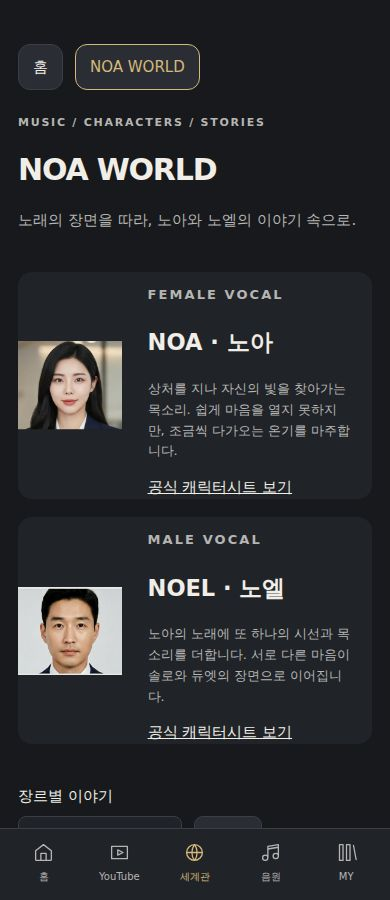
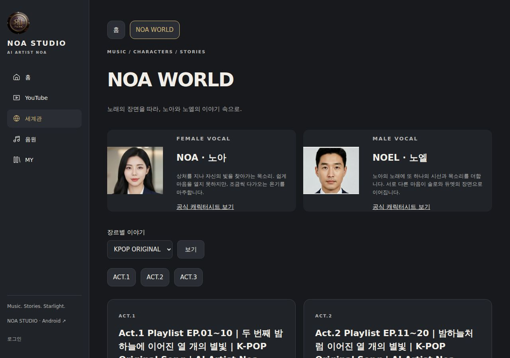

# 정식 적용·검증 결과 — 2026-10-21

첨부 지시서를 읽고 기존 검증 완료 커밋 `a5e1ff2`부터 재개했다. **이번 정식 적용은 서버 파일23개이며 전체 지시서 완료가 아니다.** 원본 자산을 임의 생성하거나 Grok을 중단하지 않았다.

## 실제 적용

- **세계관 독립 주소:** https://noastudio.ai.kr/noa-world.php. 공통 메뉴에서 직접 이동. 공개 ACT의 독립 주소·빠른 전환·원본 수록 관계에 따른 EP 챕터·공개 공식 MV/설명 펼침·세계관 커뮤니티 검색을 연결했다.
- NOA 왼쪽·NOEL 오른쪽 공식 캐릭터시트 사용. 첫 모바일 캡처에서 이전 얼굴 잘림을 발견해, 원본 시트의 앞모습 영역을 CSS로 표시하도록 수정했다. 원본 이미지 수정·신규 이미지 생성0건. 모바일390/PC1280 최종 캡처를 아래에 기록했다.
- 메인 원본 클립의 반복 재생을 켰다. 무음·인라인·자동재생 실패 시 포스터·동작 줄이기·회전 시 동일 클립 유지 동작을 보존했다. 원본 메인/심볼을 새 이미지로 대체하지 않았다.
- 홈 명칭을 ‘당신의 이야기, 우리의 음악 🎧’, ‘🎤 AInoa의 유명곡 커버’로 수정했다. 기존9섹션 순위/순서를 유지했다.
- 청취자용 가사는 알려진 제작 섹션/악기 태그만 제거한다. 미확인 대괄호 문장과 실제 노랫말을 남기고, 원본 `lyricsBlock`과 관리자 편집 데이터를 변경하지 않는다. 웹 음원·통합 곡 상세·공용 API에 적용했다. 파생 가사의 영구 DB 저장은 이번 범위에 포함하지 않았다.
- 공통 메뉴 스크립트의 캐시 버전을 기존 페이지와 그누보드 테마에 갱신했다.

**세계관 소설은 아직 승계 완료가 아니다.** 확보된 자료에서 소설 전용 프롤로그·챕터·에필로그 원문을 찾지 못했다. 화면에 연결 대기를 표시하며 곡 소개·가사를 소설이라고 보여주지 않는다. 세계관에는 공개 확인된 ACT만 표시한다. K-POP은 현재3개가 보이며 공개 플래그를 임의 변경하지 않았다. ACT.1의 실제 수록곡10개를 확인했다. 해당 ACT에서 현재 확인된 연결 공식 MV는0개다.

## 검증 근거

| 범위 | 실제 결과 |
|---|---|
| [정식 기본 배포·화면 검사](https://github.com/rucyjeon79/noa-studio/actions/runs/39517951414) | 성공. PHP 문법·Node 회귀13개·세계관 공개/소유권 검사·격리 MySQL 검증 |
| 화면 폭 | 320/360/390/430/768/1024/1280/1920px, 19경로×8=152검사, 검사 항목 내 오류0 |
| 실제 사용자 흐름 | 20개 성공. 홈9섹션·실제 영상 선택·독립 세계관/ACT/챕터·491Suno 참조·52ACT 보존·가사·MY·테마/일본어 등 |
| [얼굴 잘림 후속 수정](https://github.com/rucyjeon79/noa-studio/actions/runs/39518884619) | 성공. 수정 뒤320/390/1280px 재검사, 공식 시트 해상도·표시 영역·가로 넘침·실제 캡처 확인 |
| [최신 엔진 회귀](https://github.com/rucyjeon79/noa-studio/actions/runs/39518884740) | 성공. 격리 데이터/처리 엔진/공개 및 관리자 접근 검사 |
| 정식 HTTP | 세계관 인덱스200, 실제 ACT 상세200/챕터10개, 잘못된 ACT 식별자404, 음악 API200 |
| 원본/회원 보호 | 각 배포 전후 그누보드 코어10개 해시 일치. 이번 배포 SQL 쓰기0·회원/게시글 변경0 |
| 실제 원곡 재생/실기기 Android | 이번 성공0. 공식 플레이어 열림/합성 엔진 검사를 원곡 청취나 휴대폰 검사로 계산하지 않음 |

152검사는 마지막 인물 표시 보정 직전 전체 회귀다. 마지막 HTML/CSS 두 파일 보정 뒤에는 위3개 너비를 대상으로 관련 항목을 재검사했다. 모든 기기·동작의 무오류 보장은 아니다.

배포 전 별도 읽기 검사2건이 실패했다. `39517435965`는 새 반복 재생 기대값을 배포 전 서버에서 확인했고, `39517734478`은 새 가사 태그 기대값을 배포 전에 확인했다. 배포 이후 같은 흐름은 통과했다. 독립 홈 검사에서 소스 변경만으로 선행 검사가 실행되지 않도록 트리거를 정리했으며, 소스 변경의 운영 흐름 검사는 기존처럼 배포 후 실행한다. 실패 이력은 삭제하지 않았다.

## 실제 숫자와 한계

| 구분 | 숫자·해석 |
|---|---|
| 이번 체크아웃의 작업용 원본 곡 문서 | 601곡 + ACT52 = JSON653개. Suno URL 문서491개 |
| 기존 정식 통합 등록 | 이전 보고605곡. 이번 관리자 DB 전체 등록 수 재조회는 미실시 |
| 이번 공용 API 조회 | 544항목 = 곡492 + ACT52. 전체 정식605곡 집계와 다름 |
| 실제 로컬 원곡 파일 | 체크아웃0, 운영 API에서 검증된 음원0 |
| 확보된 Suno 1:1 커버 | 공용 API0 |
| 이번 신규 자산 이전/신규 곡 생성/병합 | 각각0 |
| 이번 원곡 마스터링/음질 전후 측정 | 0. 숫자를 만들어 표시하지 않음 |
| 이번 Android 빌드/실기기 설치/유료 생성/업로드 | 각각0 |

원본 Suno Node 모듈과 Intensity50의 실제 EQ·압축·포화 처리 정의까지 확인했다. 현 서버 엔진과 동등한 구현/운영 연결은 아직 검증하지 못했다. 저장된 Suno 공유 URL은 한 차례 HTTP200이었고 후속 조회는403이었다. HTTP 페이지 응답만으로 음원 파일·커버 확보나 재생 성공을 주장하지 않는다.

전체 요구별 구현 파일·원본 호출 경로·미완료 이유는 [지시서 대조표](42-directive-source-audit.md), 기존 자산 대장은 [자산 목록](23-asset-inventory.json), 원시 검증은 [검증 JSON](46-directive-verification.json)을 참고한다.

다음 미완료는 Suno 원곡/커버 확보 및 실제 재생, Intensity50 동등성·마스터링 MP3 캐시/WAV 임시 다운로드, 전체 JUKEBOX·관리자 재설계/충돌 되돌리기, 소설 본문 승계, 장르3그룹/아코디언, 커뮤니티 알림/댓글 통합, Android 실기기, AI 실운영·전체 독립화다. 확보하지 못한 원본과 미검증 동작을 완료로 표시하지 않았다.

## 최종 화면

## 실제 변경된 서버 파일

각 배포의 업로드 후 재읽기 SHA-256 검증 결과다. 같은 파일의 후속 변경은 최종 값으로 합쳤다. 3개 신규 파일과 기존20개 NOA 파일의 변경이며 그누보드 코어를 덮어쓰지 않았다.

| 서버 경로 | 바이트 | 최종 SHA-256 |
|---|---:|---|
| /extend/noa.design.php | 965 | `61c80d07bc0f00759458742350b4189dfb085479b29b93d570293d3be6116634` |
| /noa-ai-lab.php | 10052 | `7c81e1bb09b95868951480dc33ae448d792c0597ff275b40ec14e7f9535a0456` |
| /noa-bridge/catalog.php | 3305 | `feec5334e459867c0f10a5928e04acb18b51fbebe0c79ffd8c0ef1c86bc4dfd4` |
| /noa-bridge/sound-core.php | 4986 | `5c8b1bbe3b359983a7859359eb75f5af6229273fa4042f62e971b605d51d4600` |
| /noa-bridge/world-core.php | 619 | `f0b24ba91918bcfc27f909fb865df29b33d73222c66ba92796a48814bdeb7a29` |
| /noa-catalog-admin.php | 11012 | `a1177e3a647b428a16c9a229fc21df0f2b8fba0ef11fece6a3246d2b0cc2a5ce` |
| /noa-catalog.php | 9224 | `1d3dbcfa20da12c345e1bbca54e91ba1f9b738416f7e9dda9657a74b48138b74` |
| /noa-editor.php | 13651 | `f9eac1fdc293bd227a76dcac256cddda29604f20ba1adcfdc33b431d7cf867d5` |
| /noa-hero.js | 2819 | `27a824bb390e31b340f32e2ebec3d6cf8d5fd8f4d74311950d5fbe4f61eb733d` |
| /noa-library.php | 6505 | `e176144fbf22cc5a3e6ed2076aa567bd8979cf5a9c9b48cddca95e86bd5ff742` |
| /noa-music.php | 20014 | `4e669026b24e14c4b55c2c1e1aae47b425ca99a3e457b2d7d20f36e9321b5c04` |
| /noa-my.php | 3231 | `4d894090ab3d6ab541713422c2fc0b633d20a62b8915696b26e2b75f21b3cc76` |
| /noa-recovery.php | 4830 | `0029a7ab11f6a05f0ccae208c706dc46003d60bc31d3932631cc7f5fc297af03` |
| /noa-settings.php | 988 | `20012bb6cc022674aa22f93bdcbd395d3dce4f7b2f4cf60fe1a22b4c14e4d4e3` |
| /noa-theme-admin.php | 4592 | `94fc273852a053557554ffb42114c49ff37d00745ae51f8a469f0fb7f7fd7f52` |
| /noa-ui.js | 12511 | `1159cee5838341800b35a9a5964fb372e1ff49bfba93a9160c5b4ec343f54ece` |
| /noa-world.css | 2119 | `9c41b1a9265141f124d1434bf6f4c0825a6911d371312fb0866ade9087b69221` |
| /noa-world.php | 8832 | `de2b2ffcd90516cbaa9a69bc81b790e4d1137444cf44e2be5183f1b3a5c049c6` |
| /noa-youtube-admin.php | 4142 | `208721cedc71db34eb808b12a74ae2f7f87479bf3af8efc06ed1ec0345c5d0b9` |
| /noa-youtube.php | 7674 | `a9acdfc1beec2f8661c9c77a6723b7eeaa2820e1d8292c318f2906c7a166f73b` |
| /noa2.php | 7386 | `468023759a39be526ceb9dea5f71802a28207ff719adc71c97d438f48584e749` |
| /theme/noa_studio/head.php | 561 | `3c5f72ce5bb34d92f620bb0b0f1a89b31d2a27f765732ec5ceba3e17326b0136` |
| /theme/noa_studio/mobile/head.php | 561 | `3c5f72ce5bb34d92f620bb0b0f1a89b31d2a27f765732ec5ceba3e17326b0136` |

적용 코드: `d99ae64` → `fd86908` → `de4ee25` → `a927c99`. 정식 확인 URL은 위 세계관 주소와 https://noastudio.ai.kr/noa2.php, https://noastudio.ai.kr/noa-music.php 이다.
