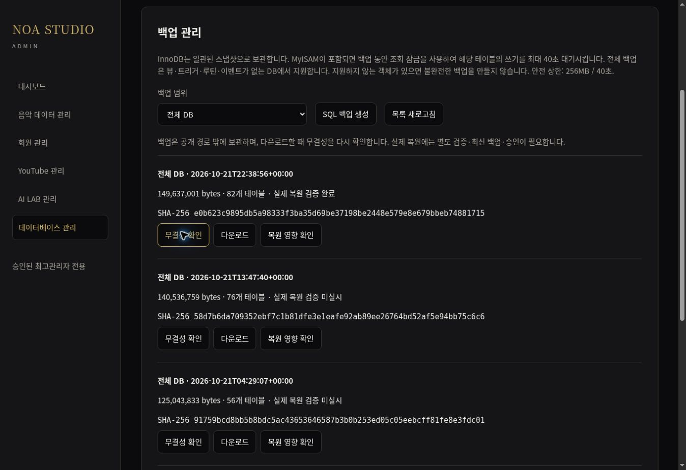

# NOA STUDIO 2.0 — 관리자·전체 DB 복원 검증 후속 결과

기준: 2026-10-22 07:48:16 KST. 마지막 완료 지점부터 이어서 실행했다.

| 항목 | 확인 결과 |
|---|---|
| GitHub 기준 | 감사 소스 `bfb56acbdc93cab3720e0ec7934c41c95396ad56`; 최신 앱 소스 `54f1adb915109ae1c645d39e9a8d3f530af8cb2a` |
| 운영 파일 비교 | 268개 전부 SHA-256 일치. missing/different 0 |
| 미배포·신규 앱 배포 | 감사 범위 내 미배포 0개, 이번 턴 앱 파일 교체 0개 |
| 최고관리자 로그인 | 실제 로그인 성공, 루트의 최고관리자 표시·로그아웃 링크 확인 |
| 세션·권한 유지 | SQL 관리자·JUKEBOX·MY 작업실 및 MY→SQL 이동에서 최고관리자 권한 유지 확인 |
| 관리자 SQL | MySQL 8.0.46, 82개 테이블, 조회 제한 3초·읽기 전용 적용. 실제 SELECT COUNT(*) 결과 곡 605개 |
| MY 작업실 | 최고관리자 작업실과 관리 링크 10개 표시 확인. 각 관리 기능의 변경 작업까지 시험한 것은 아님 |
| 새 전체 SQL 백업 | 82개 테이블, 149,637,001 bytes, 2026-10-22 07:38:56 KST 생성 |
| 격리 복원 | 임시 MySQL 8.0에 82개 테이블·35,485행 복원. 모든 테이블의 구조·행 내용 체크섬 일치 |
| 복원 결과 표시 | 운영 백업 manifest에 restoreVerified=true 기록 후 관리자 화면에서 실제 복원 검증 완료 표시 확인 |
| 데이터 보존 | 원본 문서 654개·해시 이전과 일치, 회원 2명. 운영 DB 복원·데이터 마이그레이션 없음 |
| JUKEBOX | 관리자 화면 실제 카탈로그 605곡, 이미지 454장, 재생 가능 20곡, 파일 누락 0건. 대기·처리 중 0건, 미완료 전송 1건 |
| 다운로드 | 실제 관리자 MP3 다운로드 시도 실패. 서버 요청 이력은 확인했지만 실파일 수신 성공으로 판정하지 않음 |
| 최종 판정 | **부분 성공**. 운영 코드 반영과 새 전체 DB 복원 검증 완료, 파일 수신 등 아래 검증 미완료 |

## 이번에 실제 변경한 운영 파일

앱 PHP·CSS·JS를 중복 배포하지 않았다. 새 복구 지점 및 검증 기록:

- `/hosting/noastudio/noa-db-private/15133165eb1e1d6529158ed051d94e9a.sql`
- `/hosting/noastudio/noa-db-private/15133165eb1e1d6529158ed051d94e9a.json` — 백업 manifest 및 실제 격리 복원 증거
- 기존 관리자 감사 로그에는 정상 기능 사용에 따른 조회·백업·검증 기록이 추가됐다. 다운로드 시도 역시 기존 기능의 요청 기록을 남겼다.

새 SQL 백업 SHA-256:
`e0b623c9895db5a98333f3ba35d69be37198be2448e579e8e679bbeb74881715`

그누보드 MyISAM 35개와 NOA InnoDB 테이블이 포함된 전체 백업이다. 기존 백업 모듈의 READ LOCK·40초/256MB 제한을 사용했다. 잠금의 SQL 쓰기 대기 가능성을 사전에 알렸고 실제 대기·처리 작업 0건인 상태에서 실행했다. FFmpeg·worker 프로세스와 전송 예약을 종료·초기화하지 않았다. 운영 DB에 SQL 덤프를 복원하지 않았다.

149,637,001 bytes 전부를 SFTP로 읽어 SHA-256을 대조하고 격리된 MySQL에 복원했다. 구조의 중복 charset 표기만 기존 검증 절차대로 정규화했다. 35,485행 전체 내용 체크섬이 테이블별로 일치했다. 원본 SQL·행 데이터·인증정보는 GitHub 로그나 artifact에 올리지 않았고 임시 SQL은 검증 종료 시 정리됐다.

## GitHub와 운영 배포 구분

새로 확인한 앱 소스는 `54f1adb915109ae1c645d39e9a8d3f530af8cb2a`이다. 이 소스의 기존 정식 배포 실행 39626843841은 2026-10-22 00:42:38 KST에 다음 10개 파일을 반영했으며, 본 후속 감사에서 일치함을 재확인했다:

`noa-ui.css`, `noa-ui.js`, `noa-design.json`, `noa-app/home.php`, `noa-app/world-view.php`, `noa-my.php`, `noa-youtube.php`, `noa-catalog.php`, `noa-ai-lab.php`, `noa-settings.php`.

해당 배포 백업은 `/hosting/noastudio/noa-deploy-backups/p0-39626843841-1`이다. 최초 index 원본 백업은 `/hosting/noastudio/noa-deploy-backups/root-20261021-39528375168/index.php`에 보존돼 있다.

이번 Work_배포의 GitHub 변경은 다음 운영 검증 자동화뿐이다:
- `1df3784113c62c1aa7bb0ca2b491d444f3f46b21`: 새 82개 테이블 백업의 정확한 SHA를 고정한 격리 복원·결과 기록 워크플로
- `bfb56acbdc93cab3720e0ec7934c41c95396ad56`: 최신 운영 파일의 읽기 전용 전체 감사 재실행

UI 19개 별도 운영 감사도 앱 소스 54f1adb와 모두 일치했다. 전체 감사는 정적 자산·PHP·JS 등 매핑 268개까지 확장해 모두 일치함을 확인했다. 파일별 경로·크기·수정 시각·SHA-256은 동반 JSON에 기록했다. 미병합 PR #4와 draft PR #1은 병합하지 않았다.

## 실제 운영 URL 확인

직접 HTTP 재확인 결과:
- https://noastudio.ai.kr/ — 200, 루트 메인
- https://noastudio.ai.kr/index.php — 200
- https://noastudio.ai.kr/noa2.php — 루트로 이동 후 200
- https://noastudio.ai.kr/noa-music.php — 200
- https://noastudio.ai.kr/noa-world.php — 200
- https://noastudio.ai.kr/noa-youtube.php — 200
- https://noastudio.ai.kr/noa-my.php — 200
- https://noastudio.ai.kr/bbs/login.php — 200; 별도 실제 최고관리자 로그인 완료
- https://noastudio.ai.kr/noa-bridge/home.php — 200, ok=true. 추천·EP·사연곡·커버곡·플레이리스트 각 10개

인증된 SQL 관리자 https://noastudio.ai.kr/noa-app/database/ 와 JUKEBOX https://noastudio.ai.kr/noa-app/jukebox/ 에서 실제 화면·권한을 확인했다.

최신 앱 소스의 기존 운영 UI 검사 실행 39626843841은 320·390·430·768·1024·1280·1920폭에서 61개 검사를 통과했다. 이번 턴에는 관리자 데스크톱 실제 화면을 확인했으며 물리 Android 기기를 새로 시험하지 않았다. 코드 해시 일치나 화면 폭 검사만으로 최신 추가 디자인 요구사항 전체의 완료를 뜻하지 않는다.

## 남은 오류·제약

1. **관리자 MP3 실파일 수신 실패**: 실제 링크 `/noa-app/jukebox/download.php?key=single%3Akpop-original%3A01`을 클릭했지만 브라우저 download가 실패했다. 동일 링크의 지원되는 downloadMedia 방식도 실패했다. SQL 집계 CSV는 download event 대기 시간 초과였다. 브라우저 내부 다운로드 페이지는 URL 보안 정책으로 열 수 없어 추가 우회 진단을 하지 않았다. 다운로드 실패 원인이 서비스·전송·브라우저 중 어디인지 확정하지 않았다.
2. 서버 다운로드 기록에는 두 요청이 남았다. 기대 크기는 7,637,805 bytes, 기대 SHA-256은 `891e355850b88872a9b7706410d63d6044e63f98dad94a2b94c34ed65a149db6`이다. 이 기록은 서버가 응답 전 등록하므로 **다운로드 완료 증거가 아니다**. 관련 PHP나 기존 MP3를 추정으로 바꾸지 않았다.
3. JUKEBOX 관리자 재생 클릭은 ‘이 기기에서 파일을 전송하는 동안 음악 재생을 중지합니다.’라는 기존 보호 메시지를 표시했다. 보호를 해제하거나 예약 상태·localStorage를 초기화하지 않았다. 기존 공개 MP3 재생 검증과 이번 관리자 재생 시도를 구분한다.
4. 로그아웃 후 재로그인 순환 및 일반 회원 권한의 실제 로그인 검증은 하지 않았다. 최고관리자 세션의 화면 간 유지와 보호 경로 접근만 확인했다.
5. 실제 YouTube 영상·음성 출력은 앞선 봇 확인 차단 이후 재시도하지 않았다.

최종 읽기 스냅샷 07:46:16 KST의 전체 업로드 이력은 88건(ready 78, failed 9, uploading 1)이며 현재 곡 집계는 ready 31·failed 1·uploading 1이다. QA·과거 시도가 포함되어 관리자 기본 실제 카탈로그 화면의 20곡과 다르다. 이번 작업에서 큐 claim/import/maintenance나 원본 파일 정리를 실행하지 않았다.

## 검증 기록

- [새 전체 DB 격리 복원 및 성공 manifest 기록](https://github.com/rucyjeon79/noa-studio/actions/runs/39688069328)
- [268개 운영 파일·원본 데이터·최신 SQL 백업 감사](https://github.com/rucyjeon79/noa-studio/actions/runs/39688072959)
- [최신 앱 소스의 정식 UI 배포·7폭 검사](https://github.com/rucyjeon79/noa-studio/actions/runs/39626843841)
- [UI 운영 19개 파일 읽기 전용 감사](https://github.com/rucyjeon79/noa-studio/actions/runs/39687517312)
- [현재 서버 파일별 해시 및 백업·관리자 검증 메타데이터](52-current-production-state-20261022.json)
