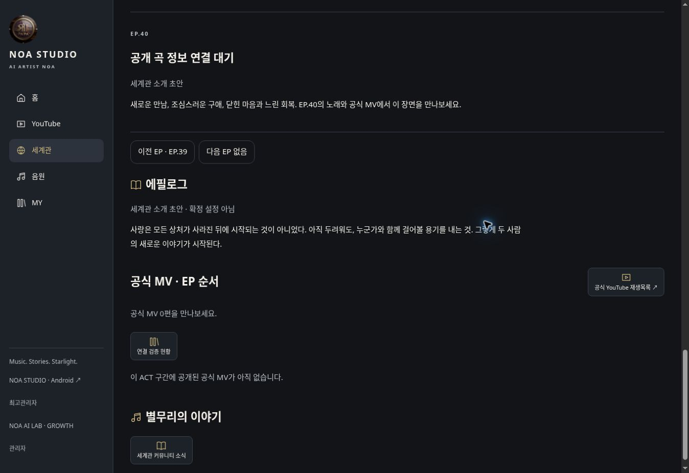
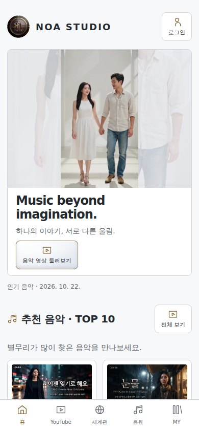
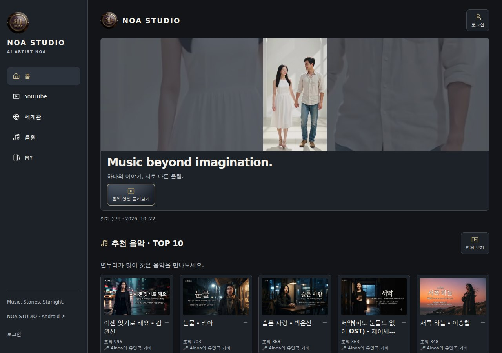

# NOA STUDIO 2.0 운영 배포 전수조사 · 2026-10-22

판정: **부분 성공**. 운영 소스 268개 전수 비교에서 미반영된 WORLD 2개 파일을 발견했다. 다른 개발 작업과 음악 처리 파일을 교체하지 않고 두 파일만 백업·배포했다. Android 새 버전은 원래 서명키 설정 부재로 배포가 차단되어 기존 APK를 보존했다. 미개발 UI와 미검증 기능을 배포 완료로 분류하지 않았다.

## 기준과 조사 범위

- 시작 main: `62f4db87056e13f13b0c0816cec8254dd7ac6cb9`.
- 최종 보고 직전 최신 main: `b971b0d24a02cfe7525ba2faadd9c49282382480`. 후속 변경은 배포·읽기 검증 자동화이며 운영 앱 소스는 배포 실행 소스와 동일하다.
- 실제 배포 실행 소스: `97c77ef705942c4276b59df9bd55162ee5ad3214`.
- WORLD 기능 소스: `02c0cd7c202c788559496adf35f2ed4f1f52b543`, 검증 보완 `7f8f5006c4fd3dc835472626ab3e7226f4f10ccd`.
- 운영 루트 `/hosting/noastudio/html`. 전체 파일 비교 실행 [39707253585](https://github.com/rucyjeon79/noa-studio/actions/runs/39707253585): 268개 중 266개 일치, 2개 버전 차이, 누락 0개. 크기·mtime·SHA-256·main 이력 비교 결과는 동반 JSON에 보존한다.
- 작업 브랜치 19개 확인: main의 조상인 13개와 이력이 갈라진 6개. 갈라진 이력 자체를 배포 가능한 새 기능으로 간주하지 않았다. PR #4 및 초안 #1은 미병합 상태로 보존했다. 이전 UI·index 브랜치는 더 최신 main/운영 파일과 충돌할 수 있어 적용하지 않았다.

## 실제 운영 파일

|서버 경로|배포 전 SHA-256|배포 후 SHA-256|
|---|---|---|
|`/hosting/noastudio/html/noa-app/world-view.php`|`858e454e4833efd7a68b085db2370f121c8b2eef26e01dfe28ee3421af20dd9d`|`4f481ebf9ba5d82065ac87c7a71ed526b38a39b79b92c48b294a648d18969a7a`|
|`/hosting/noastudio/html/noa-world.js`|`9b35ef711920ec777f3cd15cfaa458340ae5778f4856da7ab60a25a5b74bde99`|`5d1f405096a6fb1f59b30dff472765e897a31c9eb8b988471eede643be45de2d`|

WORLD JS 참조 버전은 `20261022-epnav1`로 갱신됐다. CSS 내용이 동일하므로 불필요한 교체는 하지 않았다. index/common/회원/그누보드 코어·서버 설정·JUKEBOX 처리 파일은 배포 대상에서 제외했다. 최초 index 백업은 `/hosting/noastudio/noa-deploy-backups/root-20261021-39528375168/index.php`에 보존돼 있다.

실제 배포 완료 시각 **2026-10-22 11:00:43 KST**. 이번 원본 백업은 `/hosting/noastudio/noa-deploy-backups/p0-39708240228-1/`이며 두 파일과 manifest를 비공개로 보존했다. 실행 [39708240228](https://github.com/rucyjeon79/noa-studio/actions/runs/39708240228)의 candidate·production이 모두 성공했다. 운영 화면 승인 뒤 **25개 파일을 SFTP로 다시 읽어 모두 후보 SHA와 일치**했다. 배포 시 보호 파일 36개의 해시도 유지됐다. 268개는 배포 전 전체 조사이며, 배포 후 전체 268개를 다시 읽었다는 의미가 아니다.

운영 Chrome 검사: 320/390/430/768/1024/1280/1920px 및 스마트폰 가로 2종, DARK·IVORY 검사 통과. 회복 UI 샘플 234개·재질/테마/기기 샘플 72개·카드 균형 57개·방향/정렬 30개를 검사했다. 실제 홈 영상은 자동 시작, 재생 버튼 없음, loop=false, 종료 후 paused=true, 방향 변경 후 자동 재시작 없음을 확인했다. 배포 후 보고서의 `nativeHeroEndedPaused=true`, `posterFallback=false`, `automaticReplay=false`다. 인증 역할 fixture는 실제 타 회원 로그인 시험과 구분한다.

초기 실행 39707488148은 WORLD의 정상 이전 SHA가 보호 허용 목록에 없어 **파일 교체 전에 중단**됐다. 전수조사의 실제 SHA와 main 이력 두 건만 경로별로 허용하는 보호 보완 `c19f14c88e08af0b598816227df0f750dd7d2032`, 회귀 시험 `43293f2110e72ed5a446861a86adcf128ea1b397`을 반영했다. 임의 버전이나 변조 바이트는 계속 거부한다. 로컬 배포 보호 6개 시험 및 CI 소스 검사를 통과했다.

## 운영 기능과 미완료 구분

|영역|실제 상태 / 남은 항목|
|---|---|
|루트 메인|`/`와 `/index.php` NOA 메인 HTTP 200. 기존 `noa2.php` 호환 경로 유지. 이번 루트 파일 교체 없음.|
|홈 TOP 10|추천·EP·사연곡·커버곡 각각 10개. 공개 PC/모바일 검사에서 사연곡·커버곡·플레이리스트 각 10개, 30카드 30개 고유 링크.|
|홈 미개발 UI|전체 서비스 사이트맵과 AI LAB·MY PLAYLIST 직접 진입 구성은 현재 main에 완성되지 않았다. 미배포 파일로 집계하지 않는다.|
|WORLD|공식 재생목록 MV 30개, EP 30개 연결, ACT별 10/10/10/0. EP.10→11→10 및 EP.1/40 경계의 실제 운영 이동 확인. ACT.4는 공식 MV 0개·세계관 초안/미등록 곡 상태가 그대로 표시된다. 없는 콘텐츠를 정상 재생으로 보고하지 않는다.|
|YouTube|운영 페이지·목록·영상 연결 표시 정상. 일반 YouTube 플레이어 바로 아래 설명/가사 독립 펼치기와 원문 연결은 현재 main에 미구현. 실제 YouTube 출력은 이전 봇 확인 차단으로 미검증이며 재시도하지 않았다. iframe 주소·전환 검사는 실제 스트림 재생과 구분한다.|
|음악|공개 데이터 544개 중 등록 원본 음원 20개·검증 20개. 실제 샘플 MP3 PC/모바일 재생, 시간 증가·비무음 신호·Range 206 확인. 음원이 없는 곡을 영상으로 대체하지 않았다.|
|MY PLAYLIST|현재 웹 코드에 회원 목록 조회·여러 목록·저장·이름 변경·추가/삭제가 존재한다. 순서 변경 UI는 미구현. 실제 회원 데이터를 변경하는 저장·기기 간 동기화 시험은 실행하지 않아 완료로 보고하지 않는다.|
|웹 JUKEBOX|기존 이전/재생/다음/셔플/반복 제어 보존. 요청한 완전한 2줄 배치, 닫기/목록, 양끝 시간·이미지 색상·긴 제목 효과·전체 페이지 이동 이어 듣기는 현재 웹 소스에서 완성되지 않았다. Android 구현과 혼동하지 않는다.|
|관리자|기존 최고관리자 로그인 상태에서 SQL 읽기·테이블 조회·큐 조회 확인. 익명 SQL·JUKEBOX·음원 다운로드 접근은 403. 기존 예약을 보존하기 위해 로그아웃 순환과 업로드 재예약은 실행하지 않았다. 관리자 MP3 실제 파일 수신은 앞선 브라우저 시험에서 실패해 미확인으로 남긴다.|
|AI LAB|실행 39704351246은 운영 worker 접근 성공 후 대기 작업 0개. 새 AI 생성 완료로 보고하지 않는다.|

## 통합 인기순위 · 운영 MySQL

실행 [39705953245](https://github.com/rucyjeon79/noa-studio/actions/runs/39705953245)의 성공을 실제 SQL 관리자 읽기 결과와 대조했다. `noa_ranking_runs`의 2026-10-22 01:00, 00:00 및 2026-10-21 23:00 UTC 기록이 모두 `published`, `integrated-v2`였다. 01시 집계의 실제 저장은 10:29:32 KST, collection `919a87072ef27926264d1d7e1f2dc68c`다. 영상 610개·곡 352개·MV 30개이며 YouTube 원본 동기화 시각은 2026-10-20T17:36:24Z이다. JUKEBOX 집계는 `awaiting_music_integration`, 0회로 아직 통합되지 않았다. SQL 변경이나 집계 재실행으로 보정하지 않았다.

## 데이터·백업·Music 작업 보호

이번 배포의 SQL 변경·마이그레이션·큐 초기화·음원/이미지 삭제는 0건이다. 실제 관리자 화면의 실사용 업로드는 22건, ready 20·uploading 1·queued 0·processing 0·failed 0이었다. 이력/QA를 포함하는 전체 API 집계와 혼동하지 않는다. Music worker 실행 39704220348 및 대기 실행을 취소하지 않았다. FFmpeg·FIFO·업로드 소스와 MP3는 교체하지 않았다.

이전 전체 DB 백업 `/hosting/noastudio/noa-db-private/15133165eb1e1d6529158ed051d94e9a.sql`은 149,637,001 bytes, 82개 테이블, SHA-256 `e0b623c9895db5a98333f3ba35d69be37198be2448e579e8e679bbeb74881715`다. 앞선 격리 MySQL 복원에서 35,485행 및 구조가 일치했고, 이번 조사에서 원본 스트리밍 해시를 다시 확인했다. 운영 DB에 복원하지 않았다.

배포 전 현재 보존 대상은 회원 2명·문서 654개, 문서 SHA `f569f393a4d4ee8610d060fe336d7ea4d912f5aa62fc2d9571608deb04815ee8`다. 이전 보고서의 고정 SHA와 다른 것은 이번 파일 배포 전에 이미 관측됐다. 읽기 전용 조회에서 09:25:04 KST의 기존 회원 UI 환경설정 변경 기록을 확인했다. 이를 삭제하거나 이전 DB로 되돌리지 않고 현재 값을 이번 배포 기준으로 사용했다.

배포 후 읽기 전용 확인 실행 [39709754475](https://github.com/rucyjeon79/noa-studio/actions/runs/39709754475)이 성공했다. **11:10:33 KST 검사에서 문서 654개·회원 2명, 이번 배포 전 SHA와 동일(`matchesBefore=true`)**이었다. 같은 절차에서 기존 백업 무결성도 재확인했다. worker 정지와 SQL 변경은 없었다. 이 문서 해시는 QA 이력을 제외한 기존 보존 대상이며, 계속 진행되는 업로드 상태까지 고정됐다는 의미가 아니다.

## SFTP 장애와 보호

39585613536의 직접 실패는 백업 mkdir이며 후속 lstat가 원래 오류를 가렸다. 당시 물리 파일시스템 여유는 있었지만 SFTP 일반 Failure만으로 계정 quota/호스팅 내부 제한을 확정할 수 없었다. 이후 실제 파일 쓰기·디렉터리 생성과 백업은 회복됐다. 기존 백업 삭제나 무조건 재시도는 하지 않았다. 이번 배포도 경로 정규화·전용 잠금·쓰기·백업 해시·동시 변경 검사·조건부 복원·설치 후 해시 절차를 사용했다. `cron_read_status=127`은 별도 실행 환경 제약이며 현재 처리는 외부 GitHub worker를 사용한다.

## Android 배포 제외

`aef2b183ed99027a867f19ac9d0de7293f91aa53`의 새 네이티브 연속 재생·2줄 기능은 main 병합 상태다. 실행 39704421282의 APK 빌드·시험은 성공했으나 원래 설치와 호환되는 서명키가 없어 게시 단계가 실패했다. 임시 키로 운영 APK를 교체하지 않았다. 원래 키를 GitHub의 `NOA_ANDROID_KEYSTORE_BASE64`, `NOA_ANDROID_KEY_ALIAS`, `NOA_ANDROID_KEYSTORE_PASSWORD`, `NOA_ANDROID_KEY_PASSWORD`에 안전하게 구성해야 한다. 채팅으로 비밀값을 받지 않는다.

실제 `/noa-download.php`에서 수신한 운영 APK는 **build 13**, 4,579,329 bytes, SHA-256 `2d6a5131898eeaeb8eb98a58cc799cf9fb34551511d19bbd7ce1abfe6e2a2fd2`로 manifest와 일치했다. 새 build 34 후보 및 에뮬레이터 검증은 새 버전의 운영 배포나 실제 기기 검증을 뜻하지 않는다.

## 실제 확인 URL

- https://noastudio.ai.kr/
- https://noastudio.ai.kr/index.php
- https://noastudio.ai.kr/noa2.php?view=all
- https://noastudio.ai.kr/noa-bridge/home.php
- https://noastudio.ai.kr/noa-music.php
- https://noastudio.ai.kr/noa-world.php
- https://noastudio.ai.kr/noa-world.php?story=2&genre=kpop-original&ep=11
- https://noastudio.ai.kr/noa-youtube.php
- https://noastudio.ai.kr/noa-my.php
- https://noastudio.ai.kr/bbs/login.php
- https://noastudio.ai.kr/noa-app/database/ — 관리자 인증 상태에서 조회
- https://noastudio.ai.kr/noa-app/jukebox/ — 관리자 인증 상태에서 조회
- https://noastudio.ai.kr/noa-download.php — 기존 APK 실파일 확인

공개 390/1280px 검사 실행 [39708788262](https://github.com/rucyjeon79/noa-studio/actions/runs/39708788262)는 모두 성공했다. 표시 이미지 로딩·가로 넘침·브라우저 오류 검사를 통과했다. 실기기 전체 매트릭스, 타 회원 권한, 회원 저장/로그아웃, 실제 YouTube 영상 출력, 관리자 MP3 수신은 미검증으로 유지한다.

전체 파일별 해시·시각·실제 결과는 [53-p0-production-state-20261022.json](53-p0-production-state-20261022.json)에 기록했다. 최종 수치는 운영 소스 미반영 발견 2개·실제 배포 2개·관측한 운영 매핑 파일의 남은 배포 대기 0개, 별도 Android 게시 차단 1건이다. 기능 미완성·인증/외부 재생 미검증은 위 표의 인계 항목으로 남는다.

